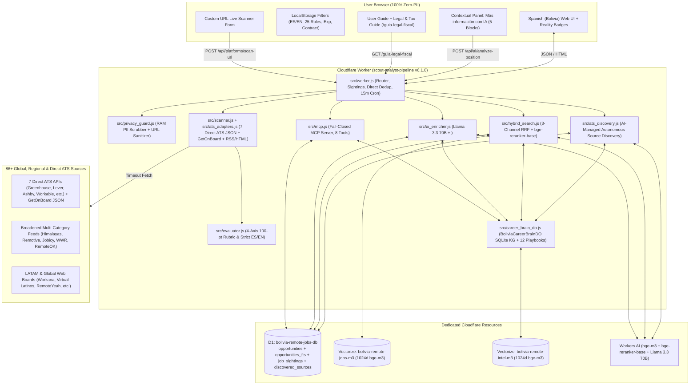

<div align="center">

<p align="center">
  <b>Language / Idioma:</b> <a href="README.md"><b>Leer en Español (README.md)</b></a> · English
</p>

# Bolivia Remote Work — Remote Job Scout & AI Evaluator

**Public, autonomous, self-contained Cloudflare Workers platform designed to discover, filter, analyze with AI, and evaluate 100% remote international job opportunities eligible from Bolivia (UTC-4).**

[](src/worker.js)
[](wrangler.toml)
[](src/career_brain_do.js)
[](wrangler.toml)
[-f59e0b?style=for-the-badge&logo=googletranslate&logoColor=white)](src/ui.js)
[](#license)

<p align="center">
  <a href="#3-layer-ai-and-memory-architecture-v600"><b>3-Layer AI &amp; Memory</b></a> •
  <a href="#end-user-guide"><b>User Guide</b></a> •
  <a href="#internal-architecture"><b>Internal Architecture</b></a> •
  <a href="#installation-and-self-hosting-guide"><b>Self-Hosting</b></a> •
  <a href="#rest-api-and-mcp-reference"><b>REST API &amp; MCP</b></a>
</p>

</div>

---

## Table of Contents

1. [What Is This Platform?](#what-is-this-platform)
2. [3-Layer AI and Memory Architecture (v6.0.0)](#3-layer-ai-and-memory-architecture-v600)
   - [Layer 1: Historical Job Memory, FTS5 BM25 & Ghost-Job Detector](#layer-1-historical-job-memory-fts5-bm25--ghost-job-detector)
   - [Layer 2: Employer, Payout & Bolivia Reality Memory (BoliviaCareerBrainDO)](#layer-2-employer-payout--bolivia-reality-memory-boliviacareerbraindo)
   - [Layer 3: Hybrid Search v2 (3-Channel RRF + Cross-Encoder) & Llama 3.3 Context Analysis](#layer-3-hybrid-search-v2-3-channel-rrf--cross-encoder--llama-33-context-analysis)
   - [Zero-PII Privacy Guard & Standalone Isolation](#zero-pii-privacy-guard--standalone-isolation)
3. [End-User Guide](#end-user-guide)
   - [Step 1: Navigation, Useful Info Menu & Light/Dark Mode](#step-1-navigation-useful-info-menu--lightdark-mode)
   - [Step 2: Customizing Filters (Languages & 25 Professional Categories)](#step-2-customizing-filters-languages--25-professional-categories)
   - [Step 3: Mandatory 100% Remote from Bolivia Eligibility Filter](#step-3-mandatory-100-remote-from-bolivia-eligibility-filter)
   - [Step 4: Score Traffic Light, Reality Badges, AI Insights & AI Search](#step-4-score-traffic-light-reality-badges-ai-insights--ai-search)
   - [Step 5: Scanning Custom Platform URLs Live](#step-5-scanning-custom-platform-urls-live)
   - [Step 6: Built-In Guides (User Guide & U.S./Bolivia Legal and Tax Guide)](#step-6-built-in-guides-user-guide--usbolivia-legal-and-tax-guide)
4. [Internal Architecture](#internal-architecture)
   - [System Flow Diagram](#system-flow-diagram)
   - [Source Module Map](#source-module-map)
   - [100-Point Dynamic Scoring Rubric](#100-point-dynamic-scoring-rubric)
   - [Ingestion Engine & 86 Monitored Public Platforms](#ingestion-engine--86-monitored-public-platforms)
   - [Syncing Custom Platforms Back to Seed Data](#syncing-custom-platforms-back-to-seed-data)
   - [On-Demand & 15-Minute Scheduled Execution](#on-demand--15-minute-scheduled-execution)
5. [Installation and Self-Hosting Guide](#installation-and-self-hosting-guide)
   - [Prerequisites](#prerequisites)
   - [Local Setup & Automated Test Suite (10 Suites)](#local-setup--automated-test-suite-10-suites)
   - [Deploying to Cloudflare Workers](#deploying-to-cloudflare-workers)
   - [Building Standalone HTML](#building-standalone-html)
6. [REST API and MCP Reference](#rest-api-and-mcp-reference)
7. [License](#license)

---

## What Is This Platform?

Searching for legitimate international remote jobs from Bolivia is often frustrating: most job boards label roles as *"remote"* while requiring U.S. physical residency, European work permits, or domestic W-2 employment — and conventional aggregators have zero memory of which companies actually pay reliably into Bolivia or which postings are recycled ghost jobs.

**Bolivia Remote Work** (`https://boliviaremote.work`) is a **free, public, open-source (GPL-3.0)** Spanish (Bolivia) platform that monitors **86 global and regional job sources**, strictly filters every ingested listing for **100% remote eligibility from Bolivia**, and augments discovery and job analysis through **Artificial Intelligence backed by a 3-layer memory architecture** (Cloudflare D1 + SQLite Durable Object + 1024d Vectorize + Workers AI).

### Key Capabilities and Enhancements (v6.1.0)

- **AI-Managed Autonomous Direct ATS Source Discovery (v6.1.0):** Every 15-minute cron cycle extracts recurring company career links from broadened multi-category aggregators (Remotive, Himalayas, Jobicy, RemoteOK, We Work Remotely, and GetOnBoard's native JSON:API), safely probes public endpoints across **7 SSRF-allowlisted ATS providers** (`Greenhouse`, `Lever`, `Ashby`, `Workable`, `SmartRecruiters`, `Recruitee`, `Breezy HR`), scores real Bolivia-eligible yield (with Spanish-role and non-DevOps scarcity bonuses), and delegates background promotion into **Monitored Platforms** (`ats_*`) to **`@cf/meta/llama-3.3-70b-instruct-fp8-fast`** backed by the 3-layer memory stack and deterministic safety guardrails — complete with Direct-Over-Aggregator deduplication precedence and self-healing `COOLDOWN` demotion.
- **3-Layer Memory + Grounded AI:** Combines relational persistence with BM25 FTS5, ghost-job repost tracking, and `discovered_sources` (`bolivia-remote-jobs-db`), an embedded employer/payout/playbook knowledge graph (`BoliviaCareerBrainDO`), and 3-channel hybrid semantic search with neural reranking (`bge-m3` + `bge-reranker-base`) plus context-compiled position analysis on `@cf/meta/llama-3.3-70b-instruct-fp8-fast`.
- **Job Cards with Live Reality Pills:** Every job card surfaces verified **Bolivia payout rail badges** (e.g., `Cobro verificado: AirTM / Payoneer / Deel`), local caution flags, **Nueva hoy** freshness tags, and **Re-publicada** ghost-job warnings.
- **Grounded "Más información con IA" v2 Panel (5 Blocks):** Opens directly below any job card (with a content-fitted, softly rounded rectangular header frame on mobile and desktop), compiles a ~1200-token `<bolivia_context>` packet, and renders overview, **Requirements**, **Useful Skills & Experience**, **Bolivia (UTC-4) Timezone Compatibility**, **Candidate Advice**, and the 5th grounded block **Realidad desde Bolivia: Contrato, Cobro e Historial**.
- **Dedicated Legal & Tax Guide (`/guia-legal-fiscal`):** Server-rendered Spanish guide ([`src/legal_tax_guide.js`](src/legal_tax_guide.js)) and Markdown edition ([`docs/guia-legal-fiscal-contratistas-bolivia.md`](docs/guia-legal-fiscal-contratistas-bolivia.md)) tailored strictly to Bolivian remote independent contractors serving U.S. clients (IRC § 862(a)(3), Forms W-8BEN/W-8BEN-E, B-1/B-2 visa boundaries, Bolivia SIN/SIAT, quarterly RC-IVA Form 610 under Law 1448 / DS 4850, Gestora Pública voluntary contributions, and contract clauses).
- **Updated Interactive User Guide (`#view-manual`):** Explains in plain Spanish how AI and 3-layer memory set the platform apart, alongside an 8-step walkthrough.
- **RAM-Only Zero-PII Privacy Guard (`src/privacy_guard.js`):** Scrubs emails, phone numbers, URLs, `@handles`, and long numeric IDs in memory before embedding or FTS5 querying (zero user query persistence) and strips tracking parameters (`utm_*`, `fbclid`, `gclid`, `ref`, `gh_src`, credentials) from scanned URLs.
- **Strict Symmetric Language Filtering (`Spanish` / `English`) & 25 Professional Categories:** Instant client/server filtering across `Spanish-only`, `English-only`, and `Both` modes.
- **Fail-Closed MCP Server (8 Tools):** Exposes 5 job search/scan/analysis tools plus 3 `BoliviaCareerBrainDO` governance tools, locked behind `MCP_API_KEY`.
- **Responsive Bolivian-Themed UI:** Light/dark mode, frosted sticky navbar, patriotic color-cycling **Información Útil** button (red -> yellow -> green), Earth-Bolivia SVG/ICO/PNG favicon, and standalone offline `index.html` support.

> [!NOTE]
> All processing runs at the edge on **Cloudflare Workers** or locally in the browser. Zero required accounts, zero tracking cookies, and zero personal data storage.

---

## 3-Layer AI and Memory Architecture (v6.0.0)

What separates **Bolivia Remote Work v6.0.0** from stateless job aggregators is persistent, domain-specific memory engineered for Bolivian remote contractors inside a single self-contained Cloudflare Worker:

### Layer 1: Historical Job Memory, FTS5 BM25 & Ghost-Job Detector
Backed by **Cloudflare D1** (`bolivia-remote-jobs-db`, [`schema.sql`](schema.sql)):
- **Persistent Job Ledger:** Replaces the legacy ~200-job ephemeral edge-cache ceiling with durable SQLite storage supporting thousands of active listings and batched writes.
- **Diacritic-Insensitive FTS5 (`opportunities_fts`):** Configured with `tokenize = 'unicode61 remove_diacritics 2'` and kept synchronized automatically via `AFTER INSERT / UPDATE / DELETE` triggers on active rows, using column-weighted BM25 (`title = 10.0`, `company = 6.0`, `tags = 5.0`, `ai_summary_es = 4.0`, `ai_summary_en = 3.0`, `description = 1.0`).
- **Cross-Board Repost & Ghost-Job Ledger (`job_sightings`):** Tracks each canonical role (`company_slug + normalized_title`), `first_seen_epoch`, `last_seen_epoch`, sighting hits, and distinct URLs/hashes:
  - `watch`: reposted across `>= 30 days` with `>= 2` distinct URLs.
  - `high`: reposted across `>= 60 days` or `>= 4` distinct URLs.
- **Automated 30-Day Expiration Hygiene:** Listings unseen across live scans for over 30 days automatically transition to `status = 'STALE'`, drop out of `opportunities_fts`, and are pruned from `bolivia-remote-jobs-m3`.

### Layer 2: Employer, Payout & Bolivia Reality Memory (`BoliviaCareerBrainDO`)
Implemented as a **SQLite-backed Durable Object** ([`src/career_brain_do.js`](src/career_brain_do.js)) seeded from [`src/career_intel_seed.js`](src/career_intel_seed.js) and paired with the dedicated `bolivia-remote-intel-m3` Vectorize index:
- **Employer & Platform Knowledge Graph (`entities` + `edges`):** Maps all **86 monitored platforms**, major global remote employers (Deel, GitLab, Canonical, Automattic, Zapier, Doist, Cloudflare, Ontop, BairesDev, etc.), Bolivia-compatible payout rails (`AirTM`, `Payoneer`, `Deel`, `Tipalti`, `USDC`, plus caution notes for `Wise` and `SWIFT USD`), EOR pathways (`Direct W-8BEN`, `Deel`, `Ontop`, `Remote.com`, `Plane`), and free upskilling bridges (`Minka Lab`, `Language Transfer`, `freeCodeCamp`).
- **12 Curated Bilingual Contractor Playbooks (`playbooks` + `playbooks_fts`):** Atomic reference guides covering Form `W-8BEN` (0% U.S. withholding on foreign-sourced independent services), `AirTM / USDC` to local BOB bank QR rails, `Payoneer` USD/EUR receiving accounts, `Wise` new-account cautions in Bolivia, `Deel / Ontop` EOR withdrawals, `Tipalti / SWIFT` fees, year-round `America/La_Paz (UTC-4)` no-DST overlap tables, ATS geo-filter survival, Track B RLHF onboarding, bilingual ops/VA strategies, technical interviews, and free upskilling.
- **Governance & Conflict Tracking (`intel_validations` + `intel_conflicts`):** Supports authenticated operator updates via `/mcp` and tracks policy drift when an employer shifts toward geo-restricted postings.
- **Automatic Self-Hosting Fallback:** Seamlessly falls back to an in-process instance + D1 mirror table (`career_brain_fallback`) when running locally or without Durable Objects.

### Layer 3: Hybrid Search v2 (3-Channel RRF + Cross-Encoder) & Llama 3.3 Context Analysis
1. **Hybrid Search v2 ([`src/hybrid_search.js`](src/hybrid_search.js)):**
   - **Stage 1 — Parallel 3-Channel Retrieval:**
     - `d1_fts` (weight `1.15`): D1 `opportunities_fts` weighted BM25 with cross-lingual ES/EN synonym expansion.
     - `vec_m3` (weight `1.20`): 1024-dim `@cf/baai/bge-m3` ANN retrieval (batch-embedded in chunks of 25) over `bolivia-remote-jobs-m3` with metadata filtering (`status`, `lang_mask`, `company_slug`, `published_epoch`).
     - `edge_128d` (weight `0.85`): Local 128-dim concept-cluster + bounded Levenshtein typo-tolerant scorer (forgiving typos like `"desarollador pyton"` or 2-letter acronyms like `"ia"`).
   - **Weighted RRF + Domain Modifiers:**
     $$\text{Score}_{\text{RRF}}(d) = \left(\sum_{c} \frac{w_c}{60 + \text{rank}_c(d)}\right) \times D_{\text{freshness}}(d) \times G_{\text{ghost}}(d) \times E_{\text{employer}}(d)$$
     combining a 21-day half-life freshness decay, ghost-job dampening ($0.72$ / $0.88$ / $1.0$), and `BoliviaCareerBrainDO` employer reality multiplier ($[0.65, 1.15]$).
   - **Stage 2 — Neural Cross-Encoder Reranking (`@cf/baai/bge-reranker-base`):** Deeply reranks the top-16 RRF candidates against the user query and blends neural relevance with the 100-point rubric score.
2. **`<bolivia_context>` Compiler & Grounded Position Analysis ([`src/ai_enricher.js`](src/ai_enricher.js)):**
   - Concurrently fetches `job_sightings` + category USD compensation benchmarks from D1 and compiles a token-budgeted (~1200 tokens) `<bolivia_context>` XML packet (1-hop KG triples capped at 40% + hybrid-retrieved, cross-encoder-reranked Bolivia playbooks).
   - Invokes **`@cf/meta/llama-3.3-70b-instruct-fp8-fast`** exclusively, isolating `<job_posting>` as untrusted data (indirect prompt-injection defense) and grounding recommendations in `<bolivia_context>`, with instant deterministic offline fallback.

### Zero-PII Privacy Guard & Standalone Isolation
- **Ephemeral RAM Scrubbing ([`src/privacy_guard.js`](src/privacy_guard.js)):** `scrubEphemeralPii()` strips emails, phone numbers, URLs, `@handles`, and long numeric IDs (`>= 7` digits) in RAM before embedding or FTS5 queries; search queries are never persisted.
- **URL Tracking-Parameter Stripping:** `sanitizePlatformUrl()` strips embedded credentials, fragments, and tracking query parameters (`utm_*`, `fbclid`, `gclid`, `ref`, `gh_src`, `session_id`, `token`, etc.) before scanning or saving.
- **100% Air-Gapped Single-Repo Portability:** All bindings (`DB`, `VECTORIZE`, `INTEL_VECTORIZE`, `CAREER_BRAIN`, `AI`) are strictly self-contained inside this Worker, ensuring full `GPL-3.0` auditability and standalone deployment.

---

## End-User Guide

```
┌─────────────────────────────────────────────────────────────────────────────┐
│ 1. Pick Languages    ──▶ 2. Adjust Filters      ──▶ 3. Review Scores &      │
│    (Spanish/English)       (25 Areas, Exp, Type)      Reality Badges        │
│                                                                             │
│ 4. AI Info / Search  ──▶ 5. Scan Custom URL     ──▶ 6. Apply Directly       │
│    (3-Layer Memory)        (Live Evaluation)          (+ Legal & Tax Guide) │
└─────────────────────────────────────────────────────────────────────────────┘
```

### Step 1: Navigation, Useful Info Menu & Light/Dark Mode
- The top bar provides a light/dark theme toggle next to the **Información Útil** menu (animated red -> yellow -> green button on desktop and mobile with automatic close and subsection folding).
- **Información Útil** contains:
  1. **Guía del Usuario: Bolivia Remote Work** (interactive guide explaining the 3-layer AI memory system and all 8 steps).
  2. **Guía Legal y Fiscal (EE. UU. y Bolivia)** (`/guia-legal-fiscal`, U.S./Bolivia legal, tax, and visa guidance for independent remote contractors).
  3. **Información Financiera y de Pago** (AirTM, Wise, Payoneer, Tipalti, and Dólar Bolivia Hoy).
  4. **Sobre el creador** (**Minka Lab** community initiative at [minkalab.net](https://minkalab.net) focused on digital education, AI skills, and language learning).
- The shared footer exposes interactive **Categorías De Plataformas** and **Plataformas Monitoreadas** pills alongside live sync metadata.

### Step 2: Customizing Filters (Languages & 25 Professional Categories)
- **1. Languages (20 pts):** Strict symmetric filtering across `Spanish-only` (default), `English-only`, or `Both` (`20/20` for all ES/EN/bilingual offers).
- **2. Experience Level (part of 20 pts):** `All levels`, `Entry (0-1 yrs)`, `Junior (1-2 yrs)`, `Mid (3-5 yrs)`, `Senior (5+ yrs)`, `Management (8+ yrs)`.
- **3. Contract Types (part of 20 pts):** `Full-Time`, `Part-Time`, `Projects / Freelance`, `Hourly / Async`, `Advisory / Consulting`.
- **4. Professional Area (35 pts, 25 Categories):** Multi-select dropdown spanning Virtual Assistant, Operations, Customer Support, Sales/SDR, Marketing, HR, Finance/Accounting, Design/Video, AI Training/RLHF, Software, Cloud/DevOps, Data/BI, Translation/Languages, Cybersecurity, Product Management, AI/LLM Engineering, QA/Testing, E-Commerce/Logistics, Legal/Compliance, Healthcare/Telemedicine, Education, Technical Writing, Customer Success, Architecture/CAD, and Banking/Fintech, plus a strict **"Hide other areas"** checkbox.

### Step 3: Mandatory 100% Remote from Bolivia Eligibility Filter
Enforced across scanning, evaluation, hybrid search, and AI analysis. Automatically excludes `US Only`, `EU Only`, `UK Only`, `W-2`-only, on-site/hybrid, travel-required, and foreign clearance postings, retaining only **Bolivia / LATAM / South America**, **Worldwide / Work From Anywhere**, and independent **W-8BEN** roles aligned with `UTC-4`.

### Step 4: Score Traffic Light, Reality Badges, AI Insights & AI Search
- Opportunities are scored `0–100` into three KPI bands: **POSTULAR** (`>= 78`), **EXPLORAR** (`58–77`), and **BAJA COINCIDENCIA** (`< 58`).
- Each card also displays memory-backed pills: **Verified Payout** (e.g., `AirTM / Payoneer / Deel`), local caution notices, **Nueva hoy**, or **Re-publicada** ghost-job alerts.
- **Buscar con IA** executes 3-channel hybrid search + cross-encoder reranking in Spanish or English (accent- and typo-tolerant), with an inline **Borrar búsqueda** reset button.
- **Más información con IA** opens a contextual 5-block analysis directly under the clicked card (with a content-fitted, softly rounded rectangular header box on mobile and desktop), including the grounded **Realidad desde Bolivia: Contrato, Cobro e Historial** block.

### Step 5: Scanning Custom Platform URLs Live
At the bottom of the main page, paste any HTML job board, RSS/Atom feed, or JSON API URL. Tracking parameters are automatically stripped, eligible Bolivia remote jobs are extracted and recorded in `job_sightings`, and results appear immediately.

### Step 6: Built-In Guides (User Guide & U.S./Bolivia Legal and Tax Guide)
Both **Guía del Usuario** (highlighting the 3-layer AI memory architecture) and **Guía Legal y Fiscal (`/guia-legal-fiscal`)** are accessible directly inside **Información Útil** and backed by [`docs/guia-legal-fiscal-contratistas-bolivia.md`](docs/guia-legal-fiscal-contratistas-bolivia.md).

---

## Internal Architecture

Built on a **Zero-Dependency Serverless** architecture on **Cloudflare Workers**, combining **Cloudflare D1** (`bolivia-remote-jobs-db`), **SQLite Durable Objects** (`BoliviaCareerBrainDO`), **Cloudflare Vectorize** (`bolivia-remote-jobs-m3` & `bolivia-remote-intel-m3`, 1024d), and **Workers AI** (`@cf/baai/bge-m3`, `@cf/baai/bge-reranker-base`, `@cf/meta/llama-3.3-70b-instruct-fp8-fast`), with graceful deterministic local fallbacks.

### System Flow Diagram



### Source Module Map

| Module | Responsibility |
| :--- | :--- |
| [`src/worker.js`](src/worker.js) | Worker entrypoint, HTTP/SSR routing (`/` & `/guia-legal-fiscal`), batched D1 persistence, `recordJobSightings`, 30-day `STALE` pruning, `*/15 * * * *` cron, and `BoliviaCareerBrainDO` export. |
| [`src/privacy_guard.js`](src/privacy_guard.js) | RAM-only PII scrubbing (`scrubEphemeralPii`), URL sanitization (`sanitizePlatformUrl`), company slug normalization, and deterministic ghost-job classification (`computeGhostJobMetrics`). |
| [`src/career_brain_do.js`](src/career_brain_do.js) | `BoliviaCareerBrainDO` SQLite Durable Object: KG entities/edges, FTS5 + `INTEL_VECTORIZE` playbooks, batch reality lookups, and ~1200-token `<bolivia_context>` compiler with local/D1 fallback. |
| [`src/career_intel_seed.js`](src/career_intel_seed.js) | Curated seed covering all 86 monitored platforms, major global remote employers, Bolivia payout rails, EORs, free upskilling bridges, and 12 bilingual contractor playbooks. |
| [`src/hybrid_search.js`](src/hybrid_search.js) | Hybrid Search v2: 3-channel Weighted RRF (`d1_fts`, `vec_m3`, `edge_128d`), freshness/ghost/employer modifiers, and `@cf/baai/bge-reranker-base` Stage-2 reranking. |
| [`src/vector_store.js`](src/vector_store.js) | Batched 25-item `@cf/baai/bge-m3` embeddings (1024d guard), local 128d cross-lingual vectors, ES/EN synonym map, semantic deduplication, and Vectorize/Qdrant indexing. |
| [`src/ai_enricher.js`](src/ai_enricher.js) | Position enrichment & grounded analysis using `@cf/meta/llama-3.3-70b-instruct-fp8-fast`, USD compensation extraction, and structured `bolivia_reality` synthesis. |
| [`src/evaluator.js`](src/evaluator.js) | 100-point rubric, mandatory 100% Bolivia remote filter, 25 categories, and live Markdown report generator. |
| [`src/scanner.js`](src/scanner.js) | Multi-format ingestion scanner (7 Direct ATS JSON APIs, GetOnBoard JSON:API, RSS/Atom, HTML, dorks) with separate human `url` vs `feed_url`, HTML stripping, and hash deduplication. |
| [`src/ats_adapters.js`](src/ats_adapters.js) | Strict SSRF allowlist across 7 ATS providers (`Greenhouse`, `Lever`, `Ashby`, `Workable`, `SmartRecruiters`, `Recruitee`, `Breezy HR`), aggregator candidate extractor, and native GetOnBoard JSON:API parser. |
| [`src/ats_discovery.js`](src/ats_discovery.js) | Autonomous background discovery engine (`v6.1.0`): ATS board probing, Spanish + non-DevOps scarcity scoring, Llama 3.3 70B + 3-layer memory promotion governance, two-way KG enrichment, and self-healing `COOLDOWN` demotion. |
| [`src/mcp.js`](src/mcp.js) | Fail-closed Streamable HTTP MCP server (`/mcp`, `/.well-known/mcp.json`) exposing 8 tools (including discovery telemetry & optional manual trigger on `inspect_career_brain_status`), 2 live resources, and 1 guided prompt. |
| [`src/ui.js`](src/ui.js) & [`src/legal_tax_guide.js`](src/legal_tax_guide.js) | Full responsive Spanish (Bolivia) UI, light/dark themes, **Monitored Platforms** filter tabs (`Todas`, `Empresas Directas (ATS)`, `Bolsas y Redes Globales`, `Agregadas por Usuarios`), card reality/ghost pills, 5-block AI panel, User Guide, and `/guia-legal-fiscal`. |
| [`schema.sql`](schema.sql) | D1 `v6.1.0` schema: `opportunities`, `opportunities_fts` + triggers, `job_sightings`, `custom_platforms` (with ATS metadata), `discovered_sources`, `career_brain_fallback`, and `evaluations`. |

### 100-Point Dynamic Scoring Rubric

$$\text{Total Score} = \text{Role \& Skills (35)} + \text{Bolivia Eligibility (25)} + \text{Contract \& Experience (20)} + \text{Languages (20)}$$

### Ingestion Engine & 86 Monitored Public Platforms
Covers 6 platform tracks: Direct B2B & Freelance (Workana, SoyFreelancer, Arc.dev, Contra), AI Training & RLHF (Outlier AI, Alignerr, DataAnnotation, Mercor, Mindrift, TELUS Digital, Welocalize, OneForma), Vetted LATAM & Global Networks (Torre.ai, GetOnBoard, Virtual Latinos, LatinHire, HireLatam, SheWorks, Toptal, Turing, Revelo, Lemon.io, Braintrust), International Portals, Expert Advisory Networks (GLG, AlphaSights, Dialectica, Guidepoint), and Curated Remote Job Boards (Himalayas, We Work Remotely, Remotive, NoDesk, DailyRemote, Jobspresso, Dynamite Jobs, RemoteOK, Working Nomads, RemoteYeah).

### Syncing Custom Platforms Back to Seed Data
```bash
npm run sync-platforms
# Or add and sync a new URL in one step:
node sync_platforms.mjs --add-url https://remoteyeah.com --name "RemoteYeah" --type html_board
```

### On-Demand & 15-Minute Scheduled Execution
- **Scheduled Cron Trigger (`*/15 * * * *`):** Rotates through monitored feeds, enriches new Bolivia-eligible postings, updates `job_sightings`, indexes 1024d vectors into `bolivia-remote-jobs-m3`, persists to D1, and marks unseen 30-day-old listings as `STALE`.
- **On-Demand:** Triggered via `/api/scan` or `/api/platforms/scan-url`.

---

## Installation and Self-Hosting Guide

### Prerequisites
- **Node.js** v20.0.0+ ([nodejs.org](https://nodejs.org/)).
- **Cloudflare account** ([dash.cloudflare.com](https://dash.cloudflare.com/)).
- **Git**.

### Local Setup & Automated Test Suite (10 Suites)

```bash
git clone https://github.com/t0m-a/boliviaremote-work-website.git
cd boliviaremote-work-website
npm run build-html && npm test
```

Runs **10 automated test suites (`1` + `1b` through `10`)** validating the responsive UI, VM sandbox live language switching, `/guia-legal-fiscal` SSR route, `#view-platforms` ATS tabs, 100% Bolivia eligibility enforcement, 25 categories, exclusive `@cf/meta/llama-3.3-70b-instruct-fp8-fast` calls, Zero-PII RAM scrubbing, URL tracking stripping, ghost-job detection, 3-channel RRF + cross-encoder reranking, `BoliviaCareerBrainDO` seeding and `<bolivia_context>` token budgets, 8 fail-closed MCP tools, autonomous SSRF-safe ATS discovery + AI-managed promotion + self-healing demotion, and zero-emoji / zero-personal-reference repository integrity.

Run locally with Wrangler:
```bash
npm run dev
```

### Deploying to Cloudflare Workers

```bash
npx wrangler login

# 1. Provision dedicated D1 database & apply v6.0.0 schema
npx wrangler d1 create bolivia-remote-jobs-db
# Set `database_id` in wrangler.toml, then apply schema remotely:
npx wrangler d1 execute bolivia-remote-jobs-db --remote --file=schema.sql --yes

# 2. Provision dual 1024-dim Vectorize indexes & metadata filters
npx wrangler vectorize create bolivia-remote-jobs-m3 --dimensions=1024 --metric=cosine
npx wrangler vectorize create-metadata-index bolivia-remote-jobs-m3 --property-name=status --type=string
npx wrangler vectorize create-metadata-index bolivia-remote-jobs-m3 --property-name=lang_mask --type=string
npx wrangler vectorize create-metadata-index bolivia-remote-jobs-m3 --property-name=company_slug --type=string
npx wrangler vectorize create-metadata-index bolivia-remote-jobs-m3 --property-name=published_epoch --type=number

npx wrangler vectorize create bolivia-remote-intel-m3 --dimensions=1024 --metric=cosine
npx wrangler vectorize create-metadata-index bolivia-remote-intel-m3 --property-name=doc_type --type=string

# 3. Optional: configure private MCP Bearer token & deploy
npx wrangler secret put MCP_API_KEY
npm run deploy
```

### Building Standalone HTML
```bash
npm run build-html
```
Packages the seed data, evaluator, guides, and deterministic offline position analyzer into a single self-contained [`index.html`](index.html).

---

## REST API and MCP Reference

| Method | Path | Parameters / Body | Description |
| :--- | :--- | :--- | :--- |
| `GET` | `/` | None | Full interactive Spanish (Bolivia) web app with live `employer_reality`, freshness, and ghost-job pills. |
| `GET` | `/guia-legal-fiscal` (`/legal-fiscal`) | None | Server-rendered **U.S. & Bolivia Legal and Tax Guide** ([`src/legal_tax_guide.js`](src/legal_tax_guide.js)). |
| `GET` | `/api/state` | None | Returns `v6.1.0` metadata, active bindings (`ai`, `d1`, `vectorize`, `intel_vectorize`, `career_brain`), `autonomous_discovery_enabled` / `direct_ats_platforms_count`, 86+ platforms, and opportunities enriched with `employer_reality`. |
| `POST` | `/api/evaluate` | JSON `{ filters: { languages, position_types, experience_levels, contract_types, strict_position_match } }` | Dynamically scores and sorts eligible jobs and generates live Markdown. |
| `POST` | `/api/scan` | Optional JSON `{ track, platform }` | Runs an on-demand scan, updates `job_sightings`, enriches, and indexes new jobs. |
| `POST` | `/api/platforms/scan-url` | JSON `{ url, name, type, track, filters }` | Sanitizes URL tracking parameters, extracts Bolivia-eligible jobs, records sightings, and persists the platform. |
| `GET` / `POST` | `/api/platforms/sync` | None | Exports/syncs `custom_*` platforms into local seed files. |
| `POST` | `/api/ai/analyze-position` | JSON `{ target_job_hash, title, company, platform_id, location, description, tags }` | Compiles `<bolivia_context>` (~1200 tokens) + `job_sightings`, runs `@cf/meta/llama-3.3-70b-instruct-fp8-fast` (with deterministic fallback), and returns all 5 blocks including `bolivia_reality`. |
| `POST` | `/api/ai/enrich` | JSON `{ job_hash, max_items }` | Enriches postings on demand via `@cf/meta/llama-3.3-70b-instruct-fp8-fast` and saves to D1. |
| `GET` / `POST` | `/api/search/semantic` | Query `?q=...` or JSON `{ query, filters, topK }` | Zero-PII Hybrid Search v2: RAM PII scrub + 3-channel RRF (`d1_fts`, `vec_m3`, `edge_128d`) + freshness/ghost/employer modifiers + `@cf/baai/bge-reranker-base`. |
| `POST` | `/api/vectors/index` | JSON `{ max_items, deduplicate }` | Batch-embeds 1024d `@cf/baai/bge-m3` vectors (chunks of 25), upserts into `bolivia-remote-jobs-m3`, and persists to D1. |
| `GET` / `POST` | `/mcp` (`/.well-known/mcp.json`) | JSON-RPC 2.0 (`Bearer MCP_API_KEY`) | Fail-closed Streamable HTTP **MCP server** with **8 tools**: `search_bolivia_remote_jobs`, `semantic_search_bolivia_jobs`, `scan_career_page_url`, `analyze_position_for_bolivia`, `list_monitored_platforms`, `upsert_employer_reality`, `upsert_bolivia_playbook`, and `inspect_career_brain_status`. |
| `GET` | `/api/results.md` | `?lang=es` or `?lang=en` | Streams a live Markdown evaluation report. |
| `GET` | `/favicon.svg` / `.ico` / `.png` | None | Vector/raster Earth-Bolivia flag favicon. |

#### Example `curl`: Zero-PII Hybrid Search v2
```bash
curl -X POST https://boliviaremote.work/api/search/semantic \
  -H "Content-Type: application/json" \
  -d '{
    "query": "python cloud devops engineer aws",
    "filters": { "languages": ["es", "en"] },
    "topK": 10
  }'
```

---

## License

This project is free and open-source software licensed under the **GNU General Public License v3.0 (GPL-3.0)**.

---

<div align="center">
  <sub>Built on Cloudflare Workers edge infrastructure to expand 100% remote international career opportunities from Bolivia to the world.</sub>
</div>
