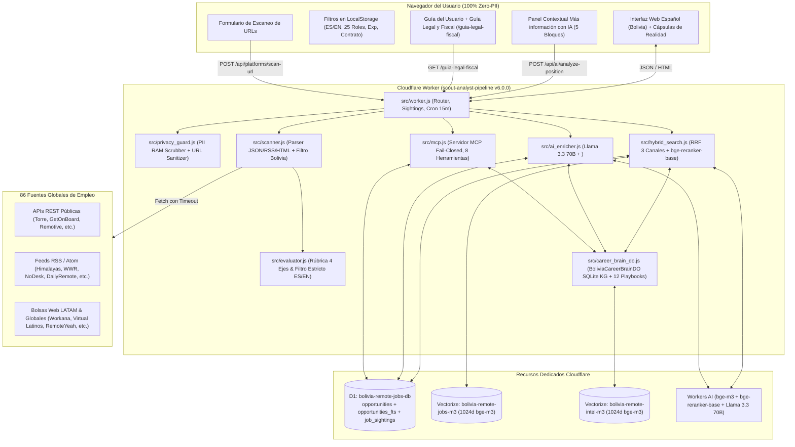

<div align="center">

<p align="center">
  <b>Idioma / Language:</b> Español (Bolivia) · <a href="README.en.md"><b>Read in English (README.en.md)</b></a>
</p>

# Buscador y Evaluador de Empleos Remotos desde Bolivia

**Plataforma pública, autónoma y auto-contenida para Cloudflare Workers diseñada para encontrar, filtrar, analizar con IA y evaluar ofertas laborales internacionales 100% remotas elegibles para trabajar desde Bolivia (UTC-4).**

[](src/worker.js)
[](wrangler.toml)
[](src/career_brain_do.js)
[](wrangler.toml)
[](src/ui.js)
[](#licencia)

<p align="center">
  <a href="#arquitectura-de-ia-y-memoria-en-3-capas-v600"><b>IA y Memoria en Capas</b></a> •
  <a href="#manual-del-usuario-final"><b>Manual de Usuario</b></a> •
  <a href="#cómo-funciona-la-arquitectura-interna"><b>Arquitectura Interna</b></a> •
  <a href="#guía-de-instalación-y-auto-alojamiento-self-hosting"><b>Auto-Alojamiento</b></a> •
  <a href="#referencia-de-la-api-rest-y-mcp"><b>API REST &amp; MCP</b></a>
</p>

</div>

---

## Tabla de Contenidos

1. [¿Qué es esta plataforma?](#qué-es-esta-plataforma)
2. [Arquitectura de IA y Memoria en 3 Capas (v6.0.0)](#arquitectura-de-ia-y-memoria-en-3-capas-v600)
   - [Capa 1: Memoria Histórica, FTS5 y Detector de Vacantes Fantasma](#capa-1-memoria-histórica-fts5-y-detector-de-vacantes-fantasma)
   - [Capa 2: Memoria de Empresas, Cobros y Guías de Bolivia (BoliviaCareerBrainDO)](#capa-2-memoria-de-empresas-cobros-y-guías-de-bolivia-boliviacareerbraindo)
   - [Capa 3: Búsqueda Híbrida v2 (RRF + Cross-Encoder) y Análisis Contextual Llama 3.3](#capa-3-búsqueda-híbrida-v2-rrf--cross-encoder-y-análisis-contextual-llama-33)
   - [Privacidad Zero-PII y Aislamiento Total](#privacidad-zero-pii-y-aislamiento-total)
3. [Manual del Usuario Final](#manual-del-usuario-final)
   - [Paso 1: Acceso, navegación y modo claro/oscuro](#paso-1-acceso-navegación-y-modo-clarooscuro)
   - [Paso 2: Configuración de tus filtros personalizados (25 Categorías)](#paso-2-configuración-de-tus-filtros-personalizados-25-categorías)
   - [Paso 3: Garantía de elegibilidad 100% Remoto desde Bolivia](#paso-3-garantía-de-elegibilidad-100-remoto-desde-bolivia)
   - [Paso 4: Semáforo, cápsulas de realidad, "Más información con IA" y "Buscar con IA"](#paso-4-semáforo-cápsulas-de-realidad-más-información-con-ia-y-buscar-con-ia)
   - [Paso 5: Escanear y evaluar URLs de plataformas personalizadas](#paso-5-escanear-y-evaluar-urls-de-plataformas-personalizadas)
   - [Paso 6: Guías integradas ("Guía del Usuario" y "Guía Legal y Fiscal")](#paso-6-guías-integradas-guía-del-usuario-y-guía-legal-y-fiscal)
4. [Cómo Funciona la Arquitectura Interna](#cómo-funciona-la-arquitectura-interna)
   - [Diagrama de flujo del sistema](#diagrama-de-flujo-del-sistema)
   - [Mapa de módulos fuente](#mapa-de-módulos-fuente)
   - [Motor de calificación y rúbrica dinámica de 100 puntos](#motor-de-calificación-y-rúbrica-dinámica-de-100-puntos)
   - [Motor de ingesta y 86 plataformas públicas monitoreadas](#motor-de-ingesta-y-86-plataformas-públicas-monitoreadas)
   - [Sincronización de plataformas personalizadas al código semilla](#sincronización-de-plataformas-personalizadas-al-código-semilla)
   - [Ciclo de ejecución bajo demanda y cron cada 15 minutos](#ciclo-de-ejecución-bajo-demanda-y-cron-cada-15-minutos)
5. [Guía de Instalación y Auto-Alojamiento (Self-Hosting)](#guía-de-instalación-y-auto-alojamiento-self-hosting)
   - [Requisitos previos](#requisitos-previos)
   - [Instalación local y pruebas (9 suites automatizadas)](#instalación-local-y-pruebas-9-suites-automatizadas)
   - [Despliegue público en Cloudflare Workers](#despliegue-público-en-cloudflare-workers)
   - [Generación de HTML autónomo (Standalone)](#generación-de-html-autónomo-standalone)
6. [Referencia de la API REST y MCP](#referencia-de-la-api-rest-y-mcp)
7. [Licencia](#licencia)

---

## ¿Qué es esta plataforma?

Buscar trabajo remoto internacional desde Bolivia suele ser frustrante: la mayoría de bolsas de empleo anuncian puestos como *"remotos"*, pero al leer las letras pequeñas exigen residencia física en Estados Unidos, permiso de trabajo en la Unión Europea o contratación local W-2, además de olvidar por completo qué empresas realmente pagan bien hacia Bolivia o cuáles re-publican la misma vacante fantasma durante meses.

**Bolivia Remote Work** (`https://boliviaremote.work`) es una **solución pública, gratuita y de código abierto (GPL-3.0)** en **Español (Bolivia)** que centraliza **86 plataformas globales y regionales**, garantiza desde la ingesta que todas las ofertas sean **100% remotas elegibles desde Bolivia**, y potencia cada búsqueda y análisis mediante **Inteligencia Artificial conectada a una arquitectura de memoria en 3 capas** (Cloudflare D1 + Durable Object SQLite + Vectorize 1024d + Workers AI).

### Resumen de Capacidades y Mejoras (v6.0.0)

- **Memoria en 3 Capas + IA Contextual:** Combina persistencia relacional con BM25 FTS5 y detector de vacantes fantasma (`bolivia-remote-jobs-db`), un grafo de conocimiento sobre empleadores, cobros y guías para Bolivia (`BoliviaCareerBrainDO`), y búsqueda híbrida semántica de 3 canales con re-ordenamiento neuronal (`bge-m3` + `bge-reranker-base`) y análisis fundamentado con `@cf/meta/llama-3.3-70b-instruct-fp8-fast`.
- **Tarjetas Enriquecidas con Cápsulas de Realidad:** Cada oferta muestra en tiempo real etiquetas verificadas de **canales de cobro compatibles en Bolivia** (`Cobro verificado: AirTM / Payoneer / Deel`), advertencias de fricción local, distintivo **Nueva hoy** o alerta **Re-publicada** cuando se detectan señales de vacante fantasma.
- **Panel Contextual `Más información con IA` v2 (5 Bloques):** Desplegado justo debajo de cada oferta (con encabezado rectangular ajustado al contenido y bordes suavemente redondeados en móvil y escritorio), compila un bloque `<bolivia_context>` (~1200 tokens) y entrega resumen, **Requisitos**, **Experiencia y habilidades útiles**, **Compatibilidad horaria con Bolivia (UTC-4)**, **Consejos para el candidato** y el 5to bloque fundamentado **Realidad desde Bolivia: Contrato, Cobro e Historial**.
- **Guía Legal y Fiscal (EE. UU. y Bolivia) (`/guia-legal-fiscal`):** Página dedicada renderizada en servidor ([`src/legal_tax_guide.js`](src/legal_tax_guide.js)) y en Markdown ([`docs/guia-legal-fiscal-contratistas-bolivia.md`](docs/guia-legal-fiscal-contratistas-bolivia.md)) con normativa verificada para contratistas independientes remotos desde Bolivia (IRC § 862(a)(3), W-8BEN/W-8BEN-E, visas B-1/B-2, SIN/SIAT, RC-IVA Form. 610 bajo Ley N° 1448 / DS N° 4850, Gestora Pública y cláusulas contractuales).
- **Guía del Usuario Renovada (`#view-manual`):** Explica de forma sencilla y sin tecnicismos cómo la IA y la memoria en 3 capas hacen única a la plataforma, junto al recorrido paso a paso de los filtros y herramientas.
- **Guardia Zero-PII en RAM (`src/privacy_guard.js`):** Limpia en memoria correos, teléfonos, URLs, `@usuarios` e IDs numéricos largos antes de ejecutar embeddings o consultas FTS5 (sin guardar consultas de usuarios), y elimina parámetros de rastreo (`utm_*`, `fbclid`, `gclid`, `ref`, `gh_src`, credenciales) en URLs escaneadas.
- **Filtro Estricto de Idiomas (`Español` / `Inglés`) y 25 Categorías Profesionales:** Refresco instantáneo en cliente y servidor con 3 modos simétricos (`Solo Español`, `Solo Inglés`, `Ambos`) y 25 áreas profesionales multi-selección.
- **Servidor MCP Fail-Closed (8 Herramientas):** Expone 5 herramientas de búsqueda/escaneo/análisis más 3 herramientas administrativas sobre `BoliviaCareerBrainDO`, protegido por `MCP_API_KEY`.
- **Interfaz Responsiva con Identidad Boliviana:** Modo claro/oscuro, barra fija con desenfoque translúcido, botón **Información Útil** con ciclo de colores patrios (**rojo → amarillo → verde**), favicon vectorial patrio (`/favicon.svg`, `/favicon.ico`, `/favicon.png`) y compatibilidad completa para HTML autónomo (`index.html`).

> [!NOTE]
> Todo el procesamiento ocurre en los servidores perimetrales de **Cloudflare Workers** o localmente en tu navegador. Cero cuentas obligatorias, cero cookies de rastreo y cero almacenamiento de datos personales.

---

## Arquitectura de IA y Memoria en 3 Capas (v6.0.0)

La diferencia fundamental de **Bolivia Remote Work v6.0.0** frente a agregadores tradicionales sin estado es que **recuerda el comportamiento real del mercado laboral remoto para Bolivia** a través de tres capas de memoria especializadas y completamente aisladas dentro del mismo Worker:

### Capa 1: Memoria Histórica, FTS5 y Detector de Vacantes Fantasma
Implementada en **Cloudflare D1** (`bolivia-remote-jobs-db`, [`schema.sql`](schema.sql)):
- **Catálogo Persistente sin Tope de Caché:** Reemplaza el límite anterior de ~200 vacantes en caché efímera por almacenamiento SQLite persistente (hasta miles de vacantes activas, carga por lotes y sincronización estructurada).
- **Índice FTS5 Insensible a Tildes (`opportunities_fts`):** Usa `tokenize = 'unicode61 remove_diacritics 2'` sincronizado automáticamente mediante disparadores `AFTER INSERT / UPDATE / DELETE` sobre vacantes activas, con ponderación BM25 por columna (`title = 10.0`, `company = 6.0`, `tags = 5.0`, `ai_summary_es = 4.0`, `ai_summary_en = 3.0`, `description = 1.0`).
- **Rastreador de Re-publicaciones (`job_sightings`):** Registra cada aparición por clave canónica (`company_slug + normalized_title`), fechas `first_seen_epoch` / `last_seen_epoch`, hashes y URLs distintas:
  - `watch`: re-publicada durante `>= 30 días` con `>= 2` URLs distintas.
  - `high`: re-publicada durante `>= 60 días` o `>= 4` URLs distintas entre bolsas.
- **Higiene Automática de Caducidad:** Las ofertas no vistas en escaneos en vivo durante más de 30 días pasan automáticamente a `status = 'STALE'`, se retiran de `opportunities_fts` y se eliminan de `bolivia-remote-jobs-m3`.

### Capa 2: Memoria de Empresas, Cobros y Guías de Bolivia (`BoliviaCareerBrainDO`)
Implementada como un **Durable Object con SQLite embebido** ([`src/career_brain_do.js`](src/career_brain_do.js)) precargado desde [`src/career_intel_seed.js`](src/career_intel_seed.js) y acoplado al índice vectorial dedicado `bolivia-remote-intel-m3`:
- **Grafo de Conocimiento (`entities` + `edges`):** Mapea las **86 plataformas monitoreadas**, empleadores remotos globales (Deel, GitLab, Canonical, Automattic, Zapier, Doist, Cloudflare, Ontop, BairesDev, etc.), vías de cobro (`AirTM`, `Payoneer`, `Deel`, `Tipalti`, `USDC`, notas de precaución para `Wise` y `SWIFT USD`), modalidades EOR (`W-8BEN Directo`, `Deel`, `Ontop`, `Remote.com`, `Plane`) y puentes gratuitos de capacitación (`Minka Lab`, `Language Transfer`, `freeCodeCamp`).
- **12 Guías Curadas Bilingües (`playbooks` + `playbooks_fts`):** Tarjetas de conocimiento práctico sobre formulario `W-8BEN` (0% retención en EE. UU.), liquidez `AirTM / USDC` a QR bancario en Bolivianos, cuentas receptoras `Payoneer`, límites de cuentas nuevas en `Wise`, cobro vía `Deel / Ontop`, comisiones `Tipalti / SWIFT`, solapamiento horario `America/La_Paz (UTC-4)` sin cambio de horario de verano, supervivencia ante filtros ATS, ingreso a plataformas RLHF (`Track B`), entrevistas técnicas y capacitación gratuita.
- **Gobierno y Auditoría (`intel_validations` + `intel_conflicts`):** Permite actualizar empleadores y guías vía MCP autenticado y registrar contradicciones de política geográfica.
- **Respaldo Portable Automático:** Cuando el Worker se ejecuta localmente o en un entorno sin Durable Objects, opera de forma transparente con instancia en memoria y tabla espejo D1 (`career_brain_fallback`).

### Capa 3: Búsqueda Híbrida v2 (RRF + Cross-Encoder) y Análisis Contextual Llama 3.3
1. **Búsqueda Híbrida v2 ([`src/hybrid_search.js`](src/hybrid_search.js)):**
   - **Etapa 1 — Generación paralela en 3 canales:**
     - `d1_fts` (peso `1.15`): BM25 sobre `opportunities_fts` + sinónimos cruzados español/inglés.
     - `vec_m3` (peso `1.20`): Búsqueda ANN de 1024 dimensiones (`@cf/baai/bge-m3` en lotes de 25) sobre `bolivia-remote-jobs-m3` con filtros de metadatos (`status`, `lang_mask`, `company_slug`, `published_epoch`).
     - `edge_128d` (peso `0.85`): Vectores semánticos locales de 128 dimensiones con grupos conceptuales bilingües y distancia de Levenshtein para tolerar errores de tipeo (*"desarollador pyton"*, *"contavilidad"*) y siglas cortas (`ia`, `qa`, `ux`).
   - **Fusión RRF + Modificadores de Dominio:**
     $$\text{Score}_{\text{RRF}}(d) = \left(\sum_{c} \frac{w_c}{60 + \text{rank}_c(d)}\right) \times D_{\text{frescura}}(d) \times G_{\text{ghost}}(d) \times E_{\text{empleador}}(d)$$
     donde $D_{\text{frescura}}$ aplica vida media de 21 días, $G_{\text{ghost}} \in \{0.72, 0.88, 1.0\}$ atenúa vacantes fantasma y $E_{\text{empleador}} \in [0.65, 1.15]$ pondera la confiabilidad del empleador desde `BoliviaCareerBrainDO`.
   - **Etapa 2 — Cross-Encoder Neuronal (`@cf/baai/bge-reranker-base`):** Re-evalúa en profundidad los 16 mejores candidatos RRF contra la consulta original y combina la señal neuronal con la rúbrica de 100 puntos.
2. **Compilador `<bolivia_context>` y "Más información con IA" v2 ([`src/ai_enricher.js`](src/ai_enricher.js)):**
   - En paralelo recopila el historial `job_sightings` + estadísticas de compensación USD por categoría desde D1 y compila un bloque XML `<bolivia_context>` ajustado a un presupuesto de **~1200 tokens** (triples 1-hop del grafo con tope del 40% + guías recuperadas por FTS5/Vectorize y re-ordenadas por `bge-reranker-base`).
   - Invoca exclusivamente **`@cf/meta/llama-3.3-70b-instruct-fp8-fast`** tratando `<job_posting>` como datos no confiables (defensa contra inyección de prompts) y fundamentando sus recomendaciones en `<bolivia_context>`, con respaldo determinístico instantáneo si Workers AI o la red no están disponibles.

### Privacidad Zero-PII y Aislamiento Total
- **Limpieza PII Efímera en RAM ([`src/privacy_guard.js`](src/privacy_guard.js)):** Antes de vectorizar o consultar FTS5, `scrubEphemeralPii()` elimina correos electrónicos, números de teléfono, URLs, `@handles` y secuencias numéricas largas (`>= 7` dígitos). Ninguna consulta de usuario se persiste ni se registra en bases de datos.
- **Sanitización de URLs:** `sanitizePlatformUrl()` elimina credenciales embebidas, fragmentos y parámetros de seguimiento (`utm_*`, `fbclid`, `gclid`, `ref`, `gh_src`, `session_id`, `token`, etc.) al escanear portales personalizados o guardar ofertas.
- **Arquitectura 100% Auto-Contenida (Air-Gapped):** Todos los enlaces (`DB`, `VECTORIZE`, `INTEL_VECTORIZE`, `CAREER_BRAIN`, `AI`) viven exclusivamente dentro de este repositorio, garantizando auditoría cívica abierta y despliegue autónomo bajo `GPL-3.0`.

---

## Manual del Usuario Final

Si utilizas la versión pública en `https://boliviaremote.work`, esta guía resume cómo aprovecharla en menos de 3 minutos.

```
┌─────────────────────────────────────────────────────────────────────────────┐
│ 1. Elige tus Idiomas ──▶ 2. Ajusta tus Filtros ──▶ 3. Revisa Semáforo y     │
│    (Español / Inglés)      (25 Áreas, Exp, Mod)      Cápsulas de Realidad   │
│                                                                             │
│ 4. Más Info / Buscar ──▶ 5. Escanea tu URL     ──▶ 6. Postula Directamente  │
│    (IA + Memoria 3C)       (Evaluación en vivo)      (+ Guía Legal/Fiscal)  │
└─────────────────────────────────────────────────────────────────────────────┘
```

### Paso 1: Acceso, navegación y modo claro/oscuro

Al abrir el portal, la aplicación carga completamente en **Español (Bolivia)** (`es-BO`) bajo la marca **Bolivia Remote Work**.

- En la esquina superior derecha tienes el botón discreto de **Modo Claro / Modo Oscuro** junto al botón animado **Información Útil** (ciclo continuo rojo → amarillo → verde en escritorio y móvil, con cierre automático y repliegue de subsecciones).
- Dentro de **Información Útil** encontrarás:
  1. **Guía del Usuario: Bolivia Remote Work** (manual interactivo con explicación clara de la IA con memoria en 3 capas y los 8 pasos de uso).
  2. **Guía Legal y Fiscal (EE. UU. y Bolivia)** (`/guia-legal-fiscal`, referencia verificada sobre impuestos, W-8BEN, visas B-1/B-2, SIN/SIAT y Gestora Pública).
  3. **Información Financiera y de Pago** (AirTM, Wise, Payoneer, Tipalti y Dólar Bolivia Hoy).
  4. **Sobre el creador** (iniciativa comunitaria **Minka Lab** en [minkalab.net](https://minkalab.net) dedicada a educación digital, IA e idiomas).
- En el **pie de página** de todas las vistas tienes las cápsulas interactivas **Categorías De Plataformas** y **Plataformas Monitoreadas**, junto al estado de sincronización.

### Paso 2: Configuración de tus filtros personalizados (25 Categorías)

En **"Personaliza tu Búsqueda y Criterios de Evaluación"**, puedes combinar criterios con refresco instantáneo:

| Filtro | Opciones Disponibles | Cómo Influye en el Puntaje |
| :--- | :--- | :--- |
| **1. Tus Idiomas** | `Español` *(por defecto)*, `Inglés` | Pondera hasta **20 puntos**. **Solo Español** excluye vacantes solo en inglés; **Solo Inglés** excluye vacantes solo en español; **Ambos** muestra la unión completa con puntaje máximo (`20/20`). |
| **2. Tu Nivel de Experiencia** | `Todos los niveles`, `Inicial / Sin Exp. (0-1 años)`, `Junior (1-2 años)`, `Semi-Senior / Mid (3-5 años)`, `Senior (5+ años)`, `Management (8+ años)` | Pondera dentro del bloque de contrato/experiencia (**20 puntos**). |
| **3. Tipo de Contrato Buscado** | `Tiempo Completo (Full-Time)`, `Medio Tiempo / Part-Time`, `Por Proyectos / Freelance`, `Por Horas / Flexible / Asíncrono`, `Consultoría / Asesoría` | Pondera dentro del bloque de contrato (**20 puntos**). |
| **4. Tipo de Posición / Área Profesional (25 Categorías)** | Desplegable multi-selección: Asistencia Virtual, Operaciones, Atención al Cliente, Ventas/SDR, Marketing, RR. HH., Finanzas/Contabilidad, Diseño/Video, Entrenamiento IA/RLHF, Software, Cloud/DevOps, Datos/BI, Traducción/Idiomas, Ciberseguridad, Producto, Ingeniería IA/LLM, QA/Testing, E-Commerce/Logística, Legal/Compliance, Salud/Telemedicina, Educación, Redacción Técnica, Customer Success, Arquitectura/CAD y Banca/Fintech. | Pondera hasta **35 puntos**. Si activas **"Ocultar ofertas de otras áreas"**, oculta estrictamente vacantes fuera de tus selecciones. |

### Paso 3: Garantía de elegibilidad 100% Remoto desde Bolivia

La elegibilidad **100% Remoto desde Bolivia** se aplica obligatoriamente en el escáner, el evaluador, la búsqueda híbrida y el análisis IA. Descarta automáticamente ofertas con residencia local extranjera (*US Only*, *EU Only*, *UK Only*, *W-2* exclusivo), modalidades presenciales/híbridas o requisitos de visado/seguridad gubernamental, conservando únicamente vacantes abiertas a **Bolivia / LATAM / Sudamérica**, **Remoto Global (Work From Anywhere)** y contratación internacional independiente (*W-8BEN*) compatible con `UTC-4`.

### Paso 4: Semáforo, cápsulas de realidad, "Más información con IA" y "Buscar con IA"

Cada vacante se evalúa sobre **100 puntos** en tres tarjetas KPI (**POSTULAR** `>= 78`, **EXPLORAR** `58–77`, **BAJA COINCIDENCIA** `< 58`) y muestra cápsulas rápidas alimentadas por la memoria en capas:
- **Cobro verificado / Verificar cobro:** Canales de pago conocidos en Bolivia (por ejemplo, `AirTM / Payoneer / Deel`) o aviso de precaución local.
- **Nueva hoy / Re-publicada Nx (D días):** Distingue oportunidades frescas frente a vacantes re-publicadas repetidamente (riesgo de vacante fantasma).

En la barra de herramientas puedes pulsar **Escanear Ofertas Ahora** o usar **Buscar con IA** (búsqueda híbrida de 3 canales + re-ordenamiento neuronal tolerante a tildes y errores de tipeo) y volver con **Borrar búsqueda**.

Al hacer clic en **"Más información con IA"** sobre cualquier oferta, se despliega justo debajo el panel **Información sobre la Posición** (con encabezado ajustado al contenido en formato rectangular de bordes suavemente redondeados) mostrando:
1. Resumen claro de la posición.
2. **Requisitos de la posición**.
3. **Experiencia y habilidades útiles**.
4. **Compatibilidad horaria con Bolivia (UTC-4)**.
5. **Consejos para el candidato**.
6. **Realidad desde Bolivia: Contrato, Cobro e Historial** (EOR/W-8BEN, canales de cobro, advertencias locales, referencia salarial e historial de re-publicaciones).

### Paso 5: Escanear y evaluar URLs de plataformas personalizadas

Al final de la página principal, el panel **"Agregar y Escanear tu Propia URL de Plataforma o Bolsa de Empleo"** acepta páginas HTML, feeds RSS/Atom o APIs JSON, sanitiza automáticamente parámetros de rastreo de la URL, extrae ofertas elegibles para Bolivia, registra sus avistamientos en `job_sightings` y las incorpora al listado al instante.

### Paso 6: Guías integradas ("Guía del Usuario" y "Guía Legal y Fiscal")

Desde **Información Útil** accedes a dos páginas integradas:
- **Guía del Usuario: Bolivia Remote Work:** Incluye el bloque visual de **IA con Memoria en 3 Capas** y el recorrido paso a paso actualizado a `v6.0.0`.
- **Guía Legal y Fiscal (EE. UU. y Bolivia)** (`/guia-legal-fiscal` y [`docs/guia-legal-fiscal-contratistas-bolivia.md`](docs/guia-legal-fiscal-contratistas-bolivia.md)): Referencia práctica para contratistas independientes remotos en Bolivia que prestan servicios a clientes estadounidenses (`26 U.S.C. § 862(a)(3)`, Formularios `W-8BEN`/`W-8BEN-E`, visas B-1/B-2 ante la Embajada en La Paz, SIN/SIAT, RC-IVA Form. 610 bajo Ley N° 1448 y DS N° 4850, Gestora Pública y cláusulas contractuales).

---

## Cómo Funciona la Arquitectura Interna

La solución está construida sobre una arquitectura **Serverless Zero-Dependency** y **100% auto-contenida** en **Cloudflare Workers**, integrando **Cloudflare D1** (`bolivia-remote-jobs-db`), **Durable Objects SQLite** (`BoliviaCareerBrainDO`), **Cloudflare Vectorize** (`bolivia-remote-jobs-m3` y `bolivia-remote-intel-m3`, 1024d) y **Workers AI** (`@cf/baai/bge-m3`, `@cf/baai/bge-reranker-base`, `@cf/meta/llama-3.3-70b-instruct-fp8-fast`), con respaldo automático determinístico en entorno local o sin enlaces de nube.

### Diagrama de flujo del sistema



### Mapa de módulos fuente

| Módulo | Responsabilidad |
| :--- | :--- |
| [`src/worker.js`](src/worker.js) | Entrypoint del Worker, enrutador HTTP/SSR (`/` y `/guia-legal-fiscal`), persistencia D1 por lotes, rastreador `recordJobSightings`, expiración `STALE` a 30 días, cron `*/15 * * * *` y exportación de `BoliviaCareerBrainDO`. |
| [`src/privacy_guard.js`](src/privacy_guard.js) | Limpieza Zero-PII en RAM (`scrubEphemeralPii`), sanitización de URLs (`sanitizePlatformUrl`), normalización de slugs (`normalizeCompanySlug`) y clasificador determinístico de vacantes fantasma (`computeGhostJobMetrics`). |
| [`src/career_brain_do.js`](src/career_brain_do.js) | `BoliviaCareerBrainDO` (SQLite Durable Object): grafo de entidades/aristas, playbooks FTS5 + `INTEL_VECTORIZE`, consulta por lotes de cápsulas de realidad y compilador `<bolivia_context>` (~1200 tokens) con respaldo local/D1. |
| [`src/career_intel_seed.js`](src/career_intel_seed.js) | Semilla curada para las 86 plataformas monitoreadas, empleadores remotos globales, vías de cobro en Bolivia, EORs, puentes gratuitos y 12 playbooks bilingües. |
| [`src/hybrid_search.js`](src/hybrid_search.js) | Búsqueda Híbrida v2: RRF ponderado de 3 canales (`d1_fts`, `vec_m3`, `edge_128d`), modificadores de frescura/ghost/empleador y cross-encoder `@cf/baai/bge-reranker-base`. |
| [`src/vector_store.js`](src/vector_store.js) | Embeddings `@cf/baai/bge-m3` en lotes de 25 (1024d con guardia de dimensión), vectores semánticos locales de 128d, sinónimos cruzados ES/EN, deduplicación semántica e indexación Vectorize/Qdrant. |
| [`src/ai_enricher.js`](src/ai_enricher.js) | Enriquecimiento y analizador contextual de posiciones con `@cf/meta/llama-3.3-70b-instruct-fp8-fast`, extracción de compensación USD y construcción estructurada de `bolivia_reality`. |
| [`src/evaluator.js`](src/evaluator.js) | Rúbrica dinámica de 100 puntos, filtro obligatorio 100% remoto Bolivia, 25 categorías profesionales y generador Markdown de resultados. |
| [`src/scanner.js`](src/scanner.js) | Escáner multi-formato (JSON API, RSS/Atom, HTML y dorks) con timeout, limpieza de HTML y deduplicación por hash. |
| [`src/mcp.js`](src/mcp.js) | Servidor MCP fail-closed sobre Streamable HTTP (`/mcp`, `/.well-known/mcp.json`) con 8 herramientas, 2 recursos y 1 prompt guiado. |
| [`src/ui.js`](src/ui.js) & [`src/legal_tax_guide.js`](src/legal_tax_guide.js) | Interfaz web responsiva completa en Español (Bolivia), modo claro/oscuro, cápsulas de realidad/ghost, panel IA de 5 bloques, Guía del Usuario y página dedicada `/guia-legal-fiscal`. |
| [`schema.sql`](schema.sql) | Esquema D1 `v6.0.0`: `opportunities`, `opportunities_fts` + triggers, `job_sightings`, `custom_platforms`, `career_brain_fallback` y `evaluations`. |

---

### Motor de calificación y rúbrica dinámica de 100 puntos

El evaluador ([`src/evaluator.js`](src/evaluator.js)) analiza cada oportunidad elegible para Bolivia en 4 dimensiones ponderadas:

$$\text{Puntaje Total} = \text{Posición y Habilidades (35)} + \text{Elegibilidad Bolivia (25)} + \text{Contrato y Nivel (20)} + \text{Idiomas (20)}$$

```
  ┌───────────────────────────────────────────────────────────────┐
  │ Posición & Habilidades: 35 pts                                │
  │   - Coincidencia con las 25 categorías profesionales          │
  │                                                               │
  │ Elegibilidad Remota Bolivia: 25 pts                           │
  │   - 25 pts: Explícitamente Bolivia / LATAM / UTC-4            │
  │   - 23 pts: Remoto Global / Work From Anywhere                │
  │   - 19 pts: Remoto internacional con traslape horario         │
  │   -  0 pts: Restringido a país local (descartada en ingesta)  │
  │                                                               │
  │ Modalidad de Contrato & Experiencia: 20 pts                   │
  │   - Contrato buscado: Full-time, Half-time, Proyectos, Horas  │
  │   - Nivel de experiencia requerido vs declarado               │
  │                                                               │
  │ Idiomas Requeridos (Español / Inglés): 20 pts                 │
  │   - Solo Español: 20 pts primario ES, 17 pts bilingüe;        │
  │     excluye ofertas solo en inglés                            │
  │   - Solo Inglés: 20 pts primario EN, 17 pts bilingüe;         │
  │     excluye ofertas solo en español                           │
  │   - Ambos (ES + EN): 20 pts para todas las ofertas ES/EN      │
  └───────────────────────────────────────────────────────────────┘
```

### Motor de ingesta y 86 plataformas públicas monitoreadas

El escáner ([`src/scanner.js`](src/scanner.js)) monitorea 86 bolsas de empleo públicas agrupadas en 6 categorías:
- **B2B Directo & Freelance:** Arc.dev, Contra, Freelancer, Workana, SoyFreelancer.
- **Entrenamiento IA & RLHF:** Outlier AI, Alignerr, DataAnnotation, Mercor, Mindrift, TELUS Digital, Welocalize, OneForma.
- **Redes LATAM & Globales:** Torre.ai, GetOnBoard, Virtual Latinos, LatinHire, HireLatam, SheWorks, Toptal, Turing, Revelo, Lemon.io, Braintrust.
- **Portales Internacionales & Globales:** Welcome to the Jungle, WeLoveDevs, Malt y redes europeas remotas.
- **Redes de Consultoría Experta:** GLG, AlphaSights, Dialectica, Guidepoint.
- **Bolsas de Empleo Remoto:** Himalayas, We Work Remotely, Remotive, NoDesk, DailyRemote, Jobspresso, Dynamite Jobs, RemoteOK, Working Nomads, RemoteYeah.

### Sincronización de plataformas personalizadas al código semilla

Cuando se agrega y escanea una nueva URL (`POST /api/platforms/scan-url`), el sistema sanitiza la URL y registra la plataforma con identificador `custom_<dominio>` en D1 y en el estado vivo (`/api/state`). Para incorporarla permanentemente en [`platforms_config.json`](platforms_config.json), [`src/seed_data.js`](src/seed_data.js) e [`index.html`](index.html):

```bash
npm run sync-platforms
# O registrar y sincronizar una URL en un solo paso:
node sync_platforms.mjs --add-url https://remoteyeah.com --name "RemoteYeah" --type html_board
```

### Ciclo de ejecución bajo demanda y cron cada 15 minutos

- **Automático en segundo plano (Cloudflare Cron Trigger):** Declarado en [`wrangler.toml`](wrangler.toml) como `crons = ["*/15 * * * *"]`. Cada 15 minutos sondea un lote rotativo de fuentes, enriquece nuevas vacantes elegibles, actualiza `job_sightings`, indexa embeddings en `bolivia-remote-jobs-m3`, persiste en D1 y marca como `STALE` ofertas no vistas en los últimos 30 días.
- **Bajo demanda del usuario:** Mediante `/api/scan` y `/api/platforms/scan-url`.

---

## Guía de Instalación y Auto-Alojamiento (Self-Hosting)

### Requisitos previos
- **Node.js** v20.0.0 o superior ([nodejs.org](https://nodejs.org/)).
- **Cuenta de Cloudflare** ([dash.cloudflare.com](https://dash.cloudflare.com/)).
- **Git** instalado en tu sistema.

### Instalación local y pruebas (9 suites automatizadas)

1. **Clonar el repositorio:**
   ```bash
   git clone https://github.com/t0m-a/boliviaremote-work-website.git
   cd boliviaremote-work-website
   ```

2. **Generar el HTML autónomo y ejecutar la suite completa de pruebas:**
   ```bash
   npm run build-html && npm test
   ```
   *Ejecuta 9 suites automáticas (`1` + `1b` a `9`) que validan:*
   - Interfaz web en Español (Bolivia), menú **Información Útil**, página dedicada `/guia-legal-fiscal`, modo oscuro, encabezado rectangular móvil `#ai-target-job-pill`, panel `#ai-position-details` (5 bloques) y ejecución en sandbox VM del cambio en vivo de vistas e idiomas.
   - Estado general con 86 plataformas y elegibilidad 100% remota Bolivia.
   - Evaluación simétrica de idiomas (`['es']`, `['en']`, `['es', 'en']`) y cobertura de las 25 categorías profesionales.
   - Reportes Markdown (`/api/results.md`), escaneo de URLs (`/api/platforms/scan-url`), enriquecimiento exclusivo con `@cf/meta/llama-3.3-70b-instruct-fp8-fast`, búsqueda híbrida (`/api/search/semantic`) y servidor MCP fail-closed (`/mcp`).
   - Favicon vectorial, `sitemap.xml` (incluyendo `/guia-legal-fiscal`), `robots.txt` y auditoría de cero datos privados y cero emojis.
   - Suite cognitiva `v6.0.0`: limpieza Zero-PII, sanitización de URLs, clasificador de vacantes fantasma, fusión RRF de 3 canales + cross-encoder `bge-reranker-base`, compilador `<bolivia_context>` de `BoliviaCareerBrainDO` y las 3 herramientas administrativas MCP.

3. **Servidor local de desarrollo:**
   ```bash
   npm run dev
   ```

### Despliegue público en Cloudflare Workers

1. **Iniciar sesión en Cloudflare:**
   ```bash
   npx wrangler login
   ```

2. **Aprovisionar los recursos dedicados (D1 + índices Vectorize 1024d) y aplicar el esquema:**
   ```bash
   npx wrangler d1 create bolivia-remote-jobs-db
   # Actualiza `database_id` en wrangler.toml con el UUID devuelto y ejecuta:
   npx wrangler d1 execute bolivia-remote-jobs-db --remote --file=schema.sql --yes

   npx wrangler vectorize create bolivia-remote-jobs-m3 --dimensions=1024 --metric=cosine
   npx wrangler vectorize create-metadata-index bolivia-remote-jobs-m3 --property-name=status --type=string
   npx wrangler vectorize create-metadata-index bolivia-remote-jobs-m3 --property-name=lang_mask --type=string
   npx wrangler vectorize create-metadata-index bolivia-remote-jobs-m3 --property-name=company_slug --type=string
   npx wrangler vectorize create-metadata-index bolivia-remote-jobs-m3 --property-name=published_epoch --type=number

   npx wrangler vectorize create bolivia-remote-intel-m3 --dimensions=1024 --metric=cosine
   npx wrangler vectorize create-metadata-index bolivia-remote-intel-m3 --property-name=doc_type --type=string
   ```

3. **Configurar el secreto MCP (opcional para habilitar `/mcp`) y desplegar:**
   ```bash
   npx wrangler secret put MCP_API_KEY
   npm run deploy
   ```

> [!IMPORTANT]
> **Cron Trigger y Migración SQLite Automáticos:**  
> Al desplegar, Cloudflare activa la migración `v1` (`new_sqlite_classes = ["BoliviaCareerBrainDO"]`) y programa la ejecución del cron cada 15 minutos sin configuración adicional.

### Generación de HTML autónomo (Standalone)

```bash
npm run build-html
```
Empaqueta los datos semilla, el evaluador, las guías y el analizador determinístico offline dentro de [`index.html`](index.html) para abrirlo localmente o alojarlo como archivo estático.

---

## Referencia de la API REST y MCP

| Método | Ruta | Parámetros / Cuerpo | Descripción |
| :--- | :--- | :--- | :--- |
| `GET` | `/` | Ninguno | Aplicación web completa en Español (Bolivia) con cápsulas `employer_reality`, frescura y alertas de re-publicación. |
| `GET` | `/guia-legal-fiscal` (`/legal-fiscal`) | Ninguno | Página SSR dedicada **Guía Legal y Fiscal (EE. UU. y Bolivia)** ([`src/legal_tax_guide.js`](src/legal_tax_guide.js)). |
| `GET` | `/api/state` | Ninguno | Estado `v6.0.0`, enlaces activos (`ai`, `d1`, `vectorize`, `intel_vectorize`, `career_brain`), 86 plataformas y vacantes con `employer_reality`. |
| `POST` | `/api/evaluate` | JSON `{ filters: { languages, position_types, experience_levels, contract_types, strict_position_match } }` | Evalúa dinámicamente el catálogo frente a tus filtros y retorna resultados ordenados + Markdown. |
| `POST` | `/api/scan` | JSON opcional `{ track, platform }` | Dispara un escaneo bajo demanda, registra `job_sightings`, enriquece e indexa nuevas vacantes. |
| `POST` | `/api/platforms/scan-url` | JSON `{ url, name, type, track, filters }` | Sanitiza la URL, extrae vacantes elegibles para Bolivia, actualiza `job_sightings` y guarda la plataforma. |
| `GET` / `POST` | `/api/platforms/sync` | Ninguno | Exporta/sincroniza plataformas `custom_*` hacia los archivos semilla locales. |
| `POST` | `/api/ai/analyze-position` | JSON `{ target_job_hash, title, company, platform_id, location, description, tags }` | Compila `<bolivia_context>` (~1200 tokens) + `job_sightings`, analiza con `@cf/meta/llama-3.3-70b-instruct-fp8-fast` (respaldo determinístico) y retorna los 5 bloques incluido `bolivia_reality`. |
| `POST` | `/api/ai/enrich` | JSON `{ job_hash, max_items }` | Enriquece vacantes bajo demanda con `@cf/meta/llama-3.3-70b-instruct-fp8-fast` y persiste en D1. |
| `GET` / `POST` | `/api/search/semantic` | Query `?q=...` o JSON `{ query, filters, topK }` | Búsqueda Híbrida v2 Zero-PII: limpieza PII en RAM + RRF de 3 canales (`d1_fts`, `vec_m3`, `edge_128d`) + frescura/ghost/empleador + Cross-Encoder `@cf/baai/bge-reranker-base`. |
| `POST` | `/api/vectors/index` | JSON `{ max_items, deduplicate }` | Genera embeddings `@cf/baai/bge-m3` en lotes de 25 (1024d), indexa en `bolivia-remote-jobs-m3` y persiste el estado en D1. |
| `GET` / `POST` | `/mcp` (`/.well-known/mcp.json`) | JSON-RPC 2.0 (`Bearer MCP_API_KEY`) | Servidor **MCP** fail-closed sobre Streamable HTTP con **8 herramientas**: `search_bolivia_remote_jobs`, `semantic_search_bolivia_jobs`, `scan_career_page_url`, `analyze_position_for_bolivia`, `list_monitored_platforms`, `upsert_employer_reality`, `upsert_bolivia_playbook` e `inspect_career_brain_status`. |
| `GET` | `/api/results.md` | `?lang=es` o `?lang=en` | Genera y descarga el reporte de resultados en Markdown puro. |
| `GET` | `/favicon.svg` / `.ico` / `.png` | Ninguno | Favicon vectorial/raster del planeta Tierra con los colores de la bandera de Bolivia. |

#### Ejemplo con `curl`: Búsqueda Híbrida v2 Zero-PII
```bash
curl -X POST https://boliviaremote.work/api/search/semantic \
  -H "Content-Type: application/json" \
  -d '{
    "query": "desarrollador python cloud aws",
    "filters": { "languages": ["es", "en"] },
    "topK": 10
  }'
```

---

## Licencia

Este proyecto es software libre y de código abierto bajo la licencia **GNU General Public License v3.0 (GPL-3.0)**. Eres libre de usarlo, estudiarlo, compartirlo y mejorarlo para beneficiar a la comunidad.

---

<div align="center">
  <sub>Construido con tecnología de borde en Cloudflare Workers para impulsar oportunidades de empleo remoto desde Bolivia hacia el mundo.</sub>
</div>
