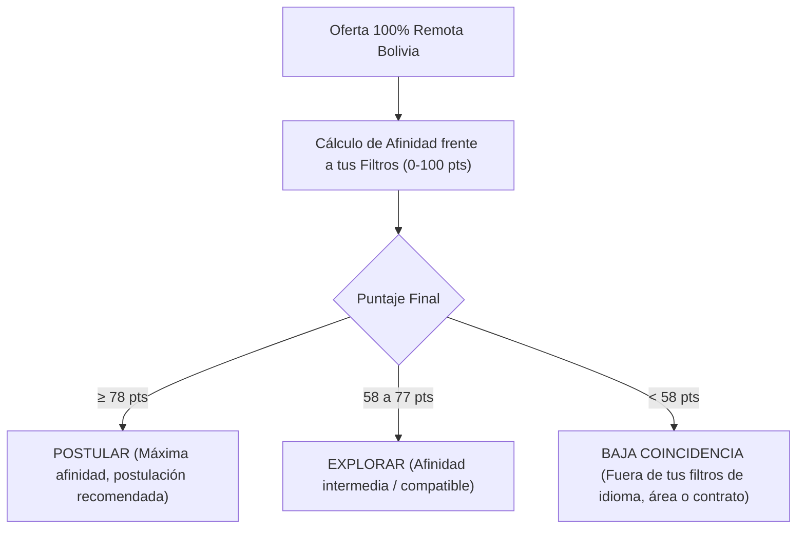
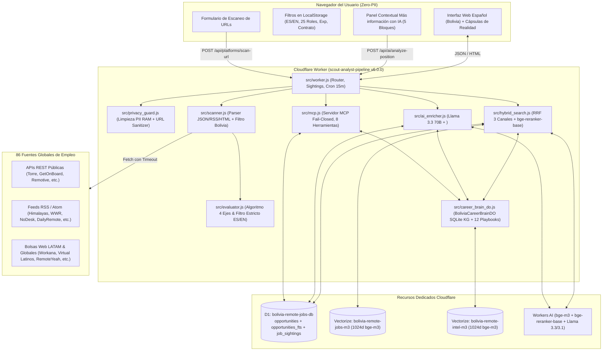

<div align="center">

# Buscador y Evaluador de Empleos Remotos desde Bolivia

**Plataforma pública, autónoma y auto-contenida para Cloudflare Workers diseñada para encontrar, filtrar y evaluar ofertas laborales internacionales 100% remotas elegibles para trabajar desde Bolivia (UTC-4).**

[](src/worker.js)
[](wrangler.toml)
[](wrangler.toml)
[](src/ui.js)
[](#licencia)

<p align="center">
  <a href="#manual-del-usuario-final"><b>Manual de Usuario</b></a> •
  <a href="#cómo-funciona-la-arquitectura-interna"><b>Arquitectura Interna</b></a> •
  <a href="#guía-de-instalación-y-auto-alojamiento-self-hosting"><b>Guía de Auto-Alojamiento</b></a> •
  <a href="#referencia-de-la-api-rest"><b>API REST</b></a>
</p>

</div>

---

## Tabla de Contenidos

1. [¿Qué es esta plataforma?](#qué-es-esta-plataforma)
2. [Manual del Usuario Final](#manual-del-usuario-final)
   - [Paso 1: Acceso, navegación y modo claro/oscuro](#paso-1-acceso-navegación-y-modo-clarooscuro)
   - [Paso 2: Configuración de tus filtros personalizados (25 Categorías)](#paso-2-configuración-de-tus-filtros-personalizados-25-categorías)
   - [Paso 3: Garantía de elegibilidad 100% Remoto desde Bolivia](#paso-3-garantía-de-elegibilidad-100-remoto-desde-bolivia)
   - [Paso 4: Semáforo de calificación, "Más información con IA" y "Buscar con IA"](#paso-4-semáforo-de-calificación-más-información-con-ia-y-buscar-con-ia)
   - [Paso 5: Escanear y evaluar URLs de plataformas personalizadas](#paso-5-escanear-y-evaluar-urls-de-plataformas-personalizadas)
   - [Paso 6: Sección interactiva "Guía del Usuario: Bolivia Remote Work"](#paso-6-sección-interactiva-guía-del-usuario-bolivia-remote-work)
3. [Cómo Funciona la Arquitectura Interna](#cómo-funciona-la-arquitectura-interna)
   - [Diagrama de flujo del sistema](#diagrama-de-flujo-del-sistema)
   - [Motor de calificación y rúbrica dinámica de 100 puntos](#motor-de-calificación-y-rúbrica-dinámica-de-100-puntos)
   - [Motor de ingesta y 86 plataformas públicas monitoreadas](#motor-de-ingesta-y-86-plataformas-públicas-monitoreadas)
   - [Sincronización de plataformas personalizadas al código semilla](#sincronización-de-plataformas-personalizadas-al-código-semilla)
   - [Ciclo de ejecución bajo demanda y cron cada 15 minutos](#ciclo-de-ejecución-bajo-demanda-y-cron-cada-15-minutos)
4. [Guía de Instalación y Auto-Alojamiento (Self-Hosting)](#guía-de-instalación-y-auto-alojamiento-self-hosting)
   - [Requisitos previos](#requisitos-previos)
   - [Instalación local y pruebas](#instalación-local-y-pruebas)
   - [Despliegue público en Cloudflare Workers](#despliegue-público-en-cloudflare-workers)
   - [Generación de HTML autónomo (Standalone)](#generación-de-html-autónomo-standalone)
5. [Referencia de la API REST](#referencia-de-la-api-rest)
6. [Licencia](#licencia)

---

## ¿Qué es esta plataforma?

Buscar trabajo remoto internacional desde Bolivia suele ser frustrante: la mayoría de bolsas de empleo anuncian puestos como *"remotos"*, pero al leer las letras pequeñas exigen residencia física en Estados Unidos, permiso de trabajo en la Unión Europea o contratación exclusiva local.

Esta herramienta es una **solución pública y gratuita** en **Español (Bolivia)** que centraliza **86 plataformas globales y regionales** (incluyendo Torre.ai, GetOnBoard, Virtual Latinos, Workana, SoyFreelancer, NoDesk, DailyRemote, Jobspresso, Dynamite Jobs, LatinHire, HireLatam, SheWorks, Himalayas, We Work Remotely, Remotive, RemoteYeah, etc.), garantizando desde la ingesta que todas las ofertas importadas y evaluadas sean **100% remotas elegibles desde Bolivia**, y calificándolas en vivo frente a tus preferencias de **idiomas (`Español` / `Inglés`), área profesional (25 categorías), nivel de experiencia y modalidad de contrato**.

### Principales Características y Novedades (v6.0)

- **Persistencia Relacional D1, Búsqueda BM25 FTS5 y Detector de Vacantes Fantasma (`job_sightings`):** Base dedicada **Cloudflare D1** (`bolivia-remote-jobs-db`, [`schema.sql`](schema.sql)) que elimina el tope anterior de 200 ofertas en caché, mantiene índice sincronizado `opportunities_fts` insensible a tildes (`unicode61 remove_diacritics 2`), registra re-publicaciones recurrentes entre portales (`ghost_risk: watch / high`) y expira automáticamente a estado `STALE` las vacantes no vistas por más de 30 días.
- **Búsqueda Híbrida v2 (`Buscar con IA` — RRF de 3 Canales + Cross-Encoder):** Motor [`src/hybrid_search.js`](src/hybrid_search.js) que fusiona en paralelo tres canales mediante *Weighted Reciprocal Rank Fusion*:
  1. `d1_fts` (peso `1.15`): BM25 sobre `opportunities_fts` con expansión de sinónimos español/inglés.
  2. `vec_m3` (peso `1.20`): Índice vectorial dedicado `bolivia-remote-jobs-m3` de 1024 dimensiones (`@cf/baai/bge-m3`) con filtros de metadatos (`status`, `lang_mask`, `company_slug`, `published_epoch`).
  3. `edge_128d` (peso `0.85`): Vectores semánticos locales de 128 dimensiones tolerantes a tildes faltantes y errores de tipeo.
  - Aplica decaimiento de frescura (vida media de 21 días), penalización de vacantes fantasma, multiplicador de realidad del empleador y **re-ordenamiento neuronal en Etapa 2 (`@cf/baai/bge-reranker-base`)** sobre los 16 mejores candidatos.
- **Grafo de Realidad del Empleador (`BoliviaCareerBrainDO` SQLite Durable Object):** Objeto Durable aislado en [`src/career_brain_do.js`](src/career_brain_do.js) y [`src/career_intel_seed.js`](src/career_intel_seed.js) con respaldo automático en memoria/D1 (`career_brain_fallback`) para despliegues sin Durable Objects. Mapea las **86 plataformas monitoreadas**, empleadores remotos globales, vías de cobro verificadas en Bolivia (`AirTM`, `Payoneer`, `Deel`, `Tipalti`, `USDC`, notas de precaución de `Wise` y `SWIFT USD`), EORs (`Deel`, `Ontop`, `Remote.com`, `Plane`, `W-8BEN Directo`) y **12 guías bilingües curadas** indexadas en FTS5 y `bolivia-remote-intel-m3`.
- **Tarjetas con Cápsulas de Realidad y Panel Contextual `Más información con IA` v2:** Cada tarjeta muestra cápsulas verificadas de **canal de cobro / precaución en Bolivia**, indicador de frescura (**Nueva hoy**) o alerta de **re-publicación recurrente**. Al pulsar **Más información con IA**, el Worker compila un bloque `<bolivia_context>` (~1200 tokens) desde `BoliviaCareerBrainDO` + `job_sightings` para alimentar `@cf/meta/llama-3.3-70b-instruct-fp8-fast` (con respaldo Llama 3.1 8B y modo offline) y despliega 5 bloques estructurados:
  - Resumen informativo de la posición.
  - **Requisitos de la posición**.
  - **Experiencia y habilidades útiles**.
  - **Compatibilidad horaria con Bolivia (UTC-4)**.
  - **Consejos para el candidato**.
  - **Realidad desde Bolivia: Contrato, Cobro e Historial** (5to bloque fundamentado en el grafo de conocimiento y el historial de publicaciones).
- **Guardia Zero-PII en RAM (`src/privacy_guard.js`):** Limpia en memoria correos electrónicos, teléfonos, URLs, `@usuarios` e identificadores numéricos largos antes de generar embeddings o consultas FTS5 (sin registrar ni almacenar consultas de usuarios), y elimina parámetros de rastreo (`utm_*`, `fbclid`, `gclid`, `ref`, `gh_src`, credenciales) en URLs escaneadas.
- **Interfaz 100% Español (Bolivia) y Diseño Responsivo:** Barra superior fija con efecto translúcido difuminado al hacer scroll, tarjetas con animación bidireccional suave, modo claro/oscuro, botón **Información Útil** con transición continua de colores patrios (**rojo → amarillo → verde**), filtro estricto simétrico de idiomas (`Español` / `Inglés`), **25 categorías profesionales**, pie de página unificado y favicon vectorial patrio (`/favicon.svg`, `/favicon.ico`, `/favicon.png`).
- **Servidor MCP Aislado (Fail-Closed, 8 Herramientas):** Expone 5 herramientas de búsqueda/escaneo/análisis más 3 herramientas administrativas sobre `BoliviaCareerBrainDO` (`upsert_employer_reality`, `upsert_bolivia_playbook`, `inspect_career_brain_status`), protegidas estrictamente mediante `MCP_API_KEY`.
- **Sincronización Automática de Nuevas Plataformas (`custom_*`):** Motor [`src/seed_sync.js`](src/seed_sync.js), script CLI [`sync_platforms.mjs`](sync_platforms.mjs) (`npm run sync-platforms`) y endpoint `/api/platforms/sync` para persistir plataformas personalizadas hacia [`platforms_config.json`](platforms_config.json) y [`src/seed_data.js`](src/seed_data.js).

> [!NOTE]
> Todo el procesamiento ocurre en tiempo real en los servidores perimetrales de **Cloudflare Workers** o localmente en tu navegador. Cero datos privados, cero cookies de rastreo y cero cuentas obligatorias.

---

## Manual del Usuario Final

Si estás utilizando la versión alojada públicamente en línea, esta guía te muestra cómo aprovecharla al máximo en menos de 3 minutos.

```
┌─────────────────────────────────────────────────────────────────────────────┐
│ 1. Elige tus Idiomas ──▶ 2. Ajusta tus Filtros ──▶ 3. Revisa tu Semáforo    │
│    (Español / Inglés)      (25 Áreas, Exp, Mod)      (Postular / Explorar)  │
│                                                                             │
│ 4. Más Info / Buscar ──▶ 5. Escanea tu URL     ──▶ 6. Postula Directamente  │
│    (IA + Vectores)         (Evaluación en vivo)      (Sin intermediarios)   │
└─────────────────────────────────────────────────────────────────────────────┘
```

### Paso 1: Acceso, navegación y modo claro/oscuro

Al abrir el portal, la aplicación carga completamente en **Español (Bolivia)** (`es-BO`) bajo la marca **Bolivia Remote Work**.

- En la esquina superior derecha tienes el botón discreto de **Modo Claro / Modo Oscuro** junto al botón animado **Información Útil** (que rota suavemente en rojo, amarillo y verde tanto en escritorio como en móvil, se cierra automáticamente al retirar el puntero o tocar fuera, y repliega todas sus subsecciones).
- Dentro de **Información Útil** encontrarás:
  1. **Guía del Usuario: Bolivia Remote Work** (manual interactivo paso a paso dentro de la propia plataforma).
  2. **Información Financiera y de Pago** (plataformas de cobro internacional: AirTM, Wise, Payoneer, Tipalti y Dólar Bolivia Hoy).
  3. **Sobre el creador** (descripción del proyecto comunitario **Minka Lab** dedicado a la educación digital, las competencias en IA y el aprendizaje de idiomas en [minkalab.net](https://minkalab.net) y enlaces de contacto).
- En el **pie de página** de todas las vistas encontrarás las cápsulas interactivas **Categorías De Plataformas** (acceso por categoría de fuente) y **Plataformas Monitoreadas** (directorio completo de las 86 fuentes), junto al estado de ejecución y última sincronización.

---

### Paso 2: Configuración de tus filtros personalizados (25 Categorías)

En la sección **"Personaliza tu Búsqueda y Criterios de Evaluación"**, puedes combinar tus criterios y ver el listado actualizarse al instante:

| Filtro | Opciones Disponibles | Cómo Influye en el Puntaje |
| :--- | :--- | :--- |
| **1. Tus Idiomas** | `Español` *(seleccionado por defecto)*, `Inglés` | Pondera hasta **20 puntos**. **Regla Estricta:** **Solo Español** excluye vacantes exclusivas en inglés; **Solo Inglés** excluye vacantes exclusivas en español; **Ambos** muestra toda la unión de vacantes en español, inglés y bilingües con puntaje máximo de idioma. |
| **2. Tu Nivel de Experiencia** | `Todos los niveles`, `Inicial / Sin Exp. (0-1 años)`, `Junior (1-2 años)`, `Semi-Senior / Mid (3-5 años)`, `Senior (5+ años)`, `Management (8+ años)` | Pondera dentro del bloque de contrato/experiencia (**20 puntos**). Menú desplegable multi-selección con cierre suave automático. |
| **3. Tipo de Contrato Buscado** | `Tiempo Completo (Full-Time)`, `Medio Tiempo / Part-Time`, `Por Proyectos / Freelance`, `Por Horas / Flexible / Asíncrono`, `Consultoría / Asesoría` | Puedes marcar uno, varios o todos. Pondera dentro del bloque de contrato (**20 puntos**). |
| **4. Tipo de Posición / Área Profesional (25 Categorías)** | Desplegable responsivo multi-selección que incluye: `Asistente Virtual & Soporte Ejecutivo`, `Coordinación de Operaciones & Proyectos`, `Atención al Cliente & Chat Support`, `Ventas Remotas, BDR & SDR`, `Marketing Digital & Contenidos`, `Recursos Humanos & Recruiting`, `Finanzas, Contabilidad & Bookkeeping`, `Diseño Gráfico, UI/UX & Video`, `Entrenamiento IA, RLHF & Anotación`, `Desarrollo de Software`, `Cloud, DevOps & Sistemas`, `Datos, BI & Machine Learning`, `Traducción, Interpretación & Idiomas`, `Ciberseguridad & Auditoría TI`, `Gestión de Producto (PM / PO)`, `Ingeniería de IA & Agentes LLM`, `QA, Testing & Automatización`, `E-Commerce & Logística`, `Legal, Compliance & Contratos`, `Salud, Telemedicina & Facturación Médica`, `Educación, Docencia & Tutorías`, `Redacción Técnica & Copywriting`, `Customer Success & Onboarding`, `Arquitectura, Ingeniería Civil & CAD` y `Banca, Seguros & Fintech`. | Pondera hasta **35 puntos**. Si lo dejas vacío o pulsas *"Ver todas las áreas"*, evalúa ofertas de todas las categorías. |

> [!TIP]
> **Casilla "Ocultar ofertas de otras áreas":**  
> Si marcas esta opción al elegir una o más categorías, el sistema filtra estrictamente cualquier vacante que no pertenezca a tus áreas seleccionadas.

---

### Paso 3: Garantía de elegibilidad 100% Remoto desde Bolivia

La elegibilidad **100% Remoto desde Bolivia** se aplica obligatoriamente en el motor de escaneo, en la evaluación, en la búsqueda vectorial y en el análisis IA. Todas las vacantes importadas y visibles pasan validación geográfica para descartar automáticamente:
- Puestos que exigen residir físicamente en Estados Unidos (*"US Only"*, *"Must reside in the US"*, contratos *W-2* exclusivos).
- Puestos restringidos a Europa (*"EU Only"*), Reino Unido (*"UK Only"*), Canadá, México u otros países locales.
- Empleos presenciales o híbridos (*"On-site"*, *"Hybrid"*, *"Travel Required"*).
- Posiciones que requieren visados o autorizaciones gubernamentales extranjeras (*"Security Clearance"*, *"TS/SCI"*).

Se conservan exclusivamente oportunidades abiertas a **Bolivia / LATAM / Sudamérica**, **100% Remoto Global (Work From Anywhere)** y esquemas internacionales por contrato independiente (*W-8BEN*) compatibles con `UTC-4`.

---

### Paso 4: Semáforo de calificación, "Más información con IA" y "Buscar con IA"

Cada vacante elegible es calificada sobre **100 puntos** y agrupada en tres tarjetas KPI responsivas:



1. **POSTULAR (Puntaje ≥ 78/100):** Alta afinidad con tus idiomas, área profesional, experiencia y modalidad. Incluye acceso directo **"Ver Oferta y Postular"** y el botón **"Más información con IA"**.
2. **EXPLORAR (Puntaje 58–77/100):** Vacantes compatibles con variaciones menores respecto a tus preferencias.
3. **BAJA COINCIDENCIA (< 58/100):** Ofertas válidas para Bolivia pero fuera de tus filtros activos.

En la barra de herramientas principal también cuentas con:
- **Todas las Elegibles / Postular / Explorar / Baja Coincidencia:** Filtra rápidamente el listado por categoría del semáforo.
- **Escanear Ofertas Ahora:** Botón verde para solicitar a Cloudflare Workers una actualización en vivo de las plataformas activas.
- **Buscar con IA:** Escribe en lenguaje natural lo que buscas (por ejemplo, *"soporte al cliente bilingüe"* o *"desarrollador Python remoto"*) —con tolerancia a tildes faltantes, errores de tipeo y términos en español o inglés— y pulsa **Buscar con IA** para ordenar las vacantes por similitud semántica vectorial; usa el botón integrado **Borrar búsqueda** o cambia cualquier filtro para volver a la lista normal.

Al hacer clic en **"Más información con IA"** sobre cualquier tarjeta, se despliega justo debajo de esa vacante el panel **Información sobre la Posición** con:
- Resumen general de la vacante.
- **Requisitos de la posición**.
- **Experiencia y habilidades útiles**.
- **Compatibilidad horaria con Bolivia (UTC-4)**.
- **Consejos para el candidato**.
- **Realidad desde Bolivia: Contrato, Cobro e Historial** (vías de cobro verificadas, modalidad W-8BEN/EOR, advertencias locales y señales de re-publicación).

El panel se cierra automáticamente al hacer clic en `×` o al desplazarte fuera de su área visible.

---

### Paso 5: Escanear y evaluar URLs de plataformas personalizadas

Al final de la página encontrarás el panel **"Agregar y Escanear tu Propia URL de Plataforma o Bolsa de Empleo"**:

1. Pega la URL (por ejemplo `https://empresa.com/careers` o `https://sitio.com/jobs.rss`).
2. *(Opcional)* Asigna un nombre descriptivo.
3. Selecciona el modo de escaneo (**Auto-detectar**, **Página Web / Bolsa HTML**, **Feed RSS / Atom XML** o **API JSON**).
4. Haz clic en **"Escanear y Evaluar URL"** para extraer, validar 100% elegibilidad para Bolivia e incorporar al instante las nuevas oportunidades a tus resultados.

---

### Paso 6: Sección interactiva "Guía del Usuario: Bolivia Remote Work"

Desde **Información Útil → Guía del Usuario: Bolivia Remote Work** accedes a la guía de 8 pasos integrada dentro de la propia aplicación (con enlaces directos a **Categorías De Plataformas** y **Plataformas Monitoreadas**), cubriendo configuración de idiomas (`Español` / `Inglés`), experiencia, contratos, áreas profesionales, filtro automático 100% remoto desde Bolivia, interpretación del semáforo, postulación directa y uso de **"Más información con IA"** junto con **"Buscar con IA"** y **"Borrar búsqueda"**.

---

## Cómo Funciona la Arquitectura Interna

La solución está construida sobre una arquitectura **Serverless Zero-Dependency** y **100% auto-contenida** en **Cloudflare Workers**, combinando estándares Web (Fetch API, Web Crypto, URL API, Cache API) con recursos dedicados de **Cloudflare D1** (`bolivia-remote-jobs-db`), **Durable Objects SQLite** (`BoliviaCareerBrainDO`), **Cloudflare Vectorize** (`bolivia-remote-jobs-m3` y `bolivia-remote-intel-m3`, 1024d) y **Workers AI** (`bge-m3`, `bge-reranker-base`, `Llama 3.3 70B` / `Llama 3.1 8B`), manteniendo respaldo automático local cuando se ejecuta sin enlaces de nube.

### Diagrama de flujo del sistema



---

### Motor de calificación y rúbrica dinámica de 100 puntos

El evaluador ([`src/evaluator.js`](src/evaluator.js)) analiza cada oportunidad elegible para Bolivia en 4 dimensiones ponderadas:

$$\text{Puntaje Total} = \text{Posición y Habilidades (35)} + \text{Elegibilidad Bolivia (25)} + \text{Contrato y Nivel (20)} + \text{Idiomas (20)}$$

```
  ┌───────────────────────────────────────────────────────────────┐
  │ Posición & Habilidades: 35 pts                                │
  │   - Coincidencia con las 25 categorías profesionales          │
  │                                                               │
  │ Elegibilidad Remota Bolivia: 25 pts                           │
  │   - 25 pts: Explícitamente Bolivia / LATAM / UTC-4            │
  │   - 23 pts: Remoto Global / Work From Anywhere                │
  │   - 19 pts: Remoto internacional con traslape horario         │
  │   -  0 pts: Restringido a país local (descartada en ingesta)  │
  │                                                               │
  │ Modalidad de Contrato & Experiencia: 20 pts                   │
  │   - Contrato buscado: Full-time, Half-time, Proyectos, Horas  │
  │   - Nivel de experiencia requerido vs declarado               │
  │                                                               │
  │ Idiomas Requeridos (Español / Inglés): 20 pts                 │
  │   - Solo Español: 20 pts primario ES, 17 pts bilingüe;        │
  │     excluye ofertas solo en inglés                            │
  │   - Solo Inglés: 20 pts primario EN, 17 pts bilingüe;         │
  │     excluye ofertas solo en español                           │
  │   - Ambos (ES + EN): 20 pts para todas las ofertas ES/EN      │
  └───────────────────────────────────────────────────────────────┘
```

---

### Motor de ingesta y 86 plataformas públicas monitoreadas

El escáner ([`src/scanner.js`](src/scanner.js)) monitorea 86 bolsas de empleo públicas agrupadas en 6 categorías:
- **B2B Directo & Freelance:** Arc.dev, Contra, Freelancer, Workana, SoyFreelancer.
- **Entrenamiento IA & RLHF:** Alignerr, DataAnnotation, Outlier, Mindrift, Remotasks.
- **Redes LATAM & Globales:** Torre.ai, GetOnBoard, Virtual Latinos, LatinHire, HireLatam, SheWorks, Turing, BairesDev.
- **Portales Europeos & Globales:** Welcome to the Jungle, WeLoveDevs, Malt, Emploi-Belgique.
- **Redes de Consultoría Experta:** GLG, AlphaSights, Dialectica, Guidepoint.
- **Bolsas de Empleo Remoto:** Himalayas, We Work Remotely, Remotive, NoDesk, DailyRemote, Jobspresso, Dynamite Jobs, RemoteOK, Working Nomads, RemoteYeah.

---

### Sincronización de plataformas personalizadas al código semilla

Cuando un usuario agrega y escanea una nueva URL mediante el panel interactivo (`POST /api/platforms/scan-url`), el sistema registra la plataforma con identificador `custom_<dominio>` en el estado vivo (`/api/state`) y en la caché perimetral.

Para incorporar de forma permanente las nuevas plataformas `custom_*` dentro de los archivos base del repositorio ([`platforms_config.json`](platforms_config.json), [`src/seed_data.js`](src/seed_data.js) e [`index.html`](index.html)):

```bash
npm run sync-platforms
```

También es posible registrar y sincronizar una nueva URL en un solo paso:

```bash
node sync_platforms.mjs --add-url https://remoteyeah.com --name "RemoteYeah" --type html_board
```

---

### Ciclo de ejecución bajo demanda y cron cada 15 minutos

La plataforma combina dos modos de refresco:

- **Automático en segundo plano (Cloudflare Cron Trigger):**  
  Declarado en [`wrangler.toml`](wrangler.toml) como `crons = ["*/15 * * * *"]`. Cada 15 minutos, el worker sondea un lote rotativo de plataformas y persiste únicamente las nuevas vacantes 100% elegibles para Bolivia en la caché perimetral.
- **Bajo demanda del usuario:**  
  La interfaz gráfica realiza llamadas a `/api/scan` y `/api/platforms/scan-url` permitiendo disparar una actualización instantánea en cualquier momento.

---

## Guía de Instalación y Auto-Alojamiento (Self-Hosting)

Puedes alojar tu propia instancia en Cloudflare en menos de 5 minutos utilizando una cuenta gratuita.

### Requisitos previos

- **Node.js** v20.0.0 o superior ([nodejs.org](https://nodejs.org/)).
- **Cuenta de Cloudflare** gratuita ([dash.cloudflare.com](https://dash.cloudflare.com/)).
- **Git** instalado en tu sistema.

---

### Instalación local y pruebas

1. **Clonar el repositorio:**
   ```bash
   git clone https://github.com/t0m-a/boliviaremote-work-website.git
   cd boliviaremote-work-website
   ```

2. **Generar el HTML autónomo y verificar la suite de pruebas automatizadas:**
   ```bash
   npm run build-html && npm test
   ```
   *Ejecuta 9 grupos de prueba automáticos que validan:*
   - Interfaz web en Español (Bolivia), menú **Información Útil**, auto-cierre suave de desplegables, botón **Arriba**, modo oscuro, cápsulas de realidad/frescura/vacante fantasma, panel contextual `#ai-position-details` (5 bloques) y ejecución real en sandbox VM del cambio en vivo de idiomas (`Solo Español`, `Ambos`, `Solo Inglés`).
   - Estado general del servicio con 86 plataformas monitoreadas y garantía de elegibilidad 100% remota desde Bolivia.
   - Evaluación simétrica de idiomas (`['es']`, `['en']`, `['es', 'en']` y respaldo limpio de valores heredados).
   - Cobertura de las 25 categorías profesionales y filtro estricto de área (`strict_position_match`).
   - Generación instantánea del reporte de resultados en Markdown (`/api/results.md`).
   - Escaneo de URLs externas (`/api/platforms/scan-url`), exportación `custom_*` (`/api/platforms/sync`), enriquecimiento de posiciones con Workers AI (`/api/ai/analyze-position` y `/api/ai/enrich`), búsqueda híbrida vectorial (`/api/search/semantic`) y servidor MCP fail-closed (`/mcp`).
   - Disponibilidad del favicon vectorial (`/favicon.svg`, `/favicon.ico`), `sitemap.xml` y `robots.txt`.
   - Auditoría estricta de integridad: cero datos privados no autorizados ni emojis en los archivos del repositorio.
   - Suite cognitiva `v6.0.0`: limpieza Zero-PII en RAM, sanitización de parámetros de rastreo en URLs, clasificación determinística de vacantes fantasma (`job_sightings`), fusión RRF de 3 canales + cross-encoder `bge-reranker-base`, grafo y compilador `<bolivia_context>` en `BoliviaCareerBrainDO`, y las 3 herramientas administrativas MCP.

3. **Iniciar el servidor local de desarrollo con Wrangler:**
   ```bash
   npm run dev
   ```
   Wrangler levantará la aplicación en `http://localhost:8787`, simulando de forma idéntica el entorno de Cloudflare Workers.

---

### Despliegue público en Cloudflare Workers

1. **Iniciar sesión en tu cuenta de Cloudflare desde la terminal:**
   ```bash
   npx wrangler login
   ```

2. **Aprovisionar los recursos dedicados (D1 + índices Vectorize 1024d) y aplicar el esquema:**
   ```bash
   npx wrangler d1 create bolivia-remote-jobs-db
   # Actualiza `database_id` en wrangler.toml con el UUID devuelto y ejecuta:
   npx wrangler d1 execute bolivia-remote-jobs-db --remote --file=schema.sql --yes

   npx wrangler vectorize create bolivia-remote-jobs-m3 --dimensions=1024 --metric=cosine
   npx wrangler vectorize create-metadata-index bolivia-remote-jobs-m3 --property-name=status --type=string
   npx wrangler vectorize create-metadata-index bolivia-remote-jobs-m3 --property-name=lang_mask --type=string
   npx wrangler vectorize create-metadata-index bolivia-remote-jobs-m3 --property-name=company_slug --type=string
   npx wrangler vectorize create-metadata-index bolivia-remote-jobs-m3 --property-name=published_epoch --type=number

   npx wrangler vectorize create bolivia-remote-intel-m3 --dimensions=1024 --metric=cosine
   npx wrangler vectorize create-metadata-index bolivia-remote-intel-m3 --property-name=doc_type --type=string
   ```

3. **Publicar el Worker y la migración SQLite de `BoliviaCareerBrainDO` a nivel mundial:**
   ```bash
   npm run deploy
   ```

> [!IMPORTANT]
> **El Cron Trigger queda activo automáticamente:**  
> Al desplegar, Cloudflare programa la ejecución del escaneo cada 15 minutos sin que tengas que configurar tareas de cron en Linux ni administradores de tareas en Windows.

---

### Generación de HTML autónomo (Standalone)

Si deseas utilizar la interfaz como un archivo HTML único sin desplegar el Worker (por ejemplo, para abrirlo localmente en tu navegador o alojarlo en GitHub Pages / Nginx):

```bash
npm run build-html
```

Este comando empaqueta los datos base, el evaluador y el analizador determinístico de posiciones directamente dentro de [`index.html`](index.html), permitiendo abrir el archivo en cualquier navegador con doble clic.

---

## Referencia de la API REST

El worker expone endpoints HTTP estándar para integraciones externas:

| Método | Ruta | Parámetros / Cuerpo | Descripción |
| :--- | :--- | :--- | :--- |
| `GET` | `/` | Ninguno | Retorna la aplicación web interactiva completa en Español (Bolivia) (HTML5/CSS3/JS). |
| `GET` | `/api/state` | Ninguno | Retorna el estado v6.0.0, enlaces activos (`ai`, `d1`, `vectorize`, `intel_vectorize`, `career_brain`), 86 plataformas y ofertas elegibles enriquecidas con cápsulas `employer_reality`. |
| `POST` | `/api/evaluate` | JSON `{ filters: { languages, position_types, experience_levels, contract_types, strict_position_match } }` | Evalúa dinámicamente el catálogo frente a los filtros provistos (`languages`: `["es"]`, `["en"]` o `["es","en"]`) y retorna las ofertas ordenadas con sus puntajes. |
| `POST` | `/api/scan` | JSON opcional `{ track, platform }` | Ejecuta un escaneo de actualización bajo demanda, registra avistamientos (`job_sightings`) e indexa nuevas vacantes elegibles. |
| `POST` | `/api/platforms/scan-url` | JSON `{ url, name, type, track, filters }` | Sanitiza la URL (elimina `utm_*`, `fbclid`, `gclid`, `ref`, `gh_src`), extrae ofertas 100% elegibles para Bolivia, registra `job_sightings` y las añade a la base. |
| `GET` / `POST` | `/api/platforms/sync` | Ninguno | Exporta las plataformas personalizadas (`custom_*`) y sus oportunidades asociadas desde el estado vivo, sincronizándolas con los archivos semilla cuando el sistema de archivos local está disponible. |
| `POST` | `/api/ai/analyze-position` | JSON `{ target_job_hash, title, company, platform_id, location, description, tags }` | Compila `<bolivia_context>` (~1200 tokens) desde `BoliviaCareerBrainDO` + `job_sightings`, analiza con `@cf/meta/llama-3.3-70b-instruct-fp8-fast` (respaldo Llama 3.1 8B / `edge-position-analyzer`) y devuelve resumen, requisitos, habilidades, compatibilidad `UTC-4`, consejos y bloque `bolivia_reality`. |
| `POST` | `/api/ai/enrich` | JSON `{ job_hash, max_items }` | Enriquece oportunidades bajo demanda con Cloudflare Workers AI (`env.AI`), extrayendo remuneración referencial en USD y resúmenes ejecutivos. |
| `GET` / `POST` | `/api/search/semantic` | Query `?q=...` o JSON `{ query, filters, topK }` | Búsqueda Híbrida v2 Zero-PII: limpieza PII en RAM + RRF de 3 canales (`d1_fts`, `vec_m3`, `edge_128d`) + frescura/ghost/empleador + Cross-Encoder `@cf/baai/bge-reranker-base`. |
| `POST` | `/api/vectors/index` | JSON `{ max_items, deduplicate }` | Genera embeddings `@cf/baai/bge-m3` en lotes de 25 (1024d), indexa en `bolivia-remote-jobs-m3` (`env.VECTORIZE`) y persiste el estado en D1. |
| `GET` / `POST` | `/mcp` (`/.well-known/mcp.json`) | JSON-RPC 2.0 (`initialize`, `tools/list`, `tools/call`, `resources/read`) | Servidor **Model Context Protocol (MCP)** fail-closed sobre Streamable HTTP (protegido por `MCP_API_KEY`) con **8 herramientas** (5 de búsqueda/escaneo/análisis + 3 de gobierno sobre `BoliviaCareerBrainDO`: `upsert_employer_reality`, `upsert_bolivia_playbook`, `inspect_career_brain_status`) y 2 recursos en vivo. |
| `GET` | `/api/results.md` | Query: `?lang=es` o `?lang=en` | Genera y descarga el reporte de Resultados al instante en formato Markdown puro. |
| `GET` | `/favicon.svg` | Ninguno | Retorna el favicon vectorial en SVG del planeta Tierra con los colores de la bandera de Bolivia (`#EF4444`, `#FDE047`, `#10B981`). |
| `GET` | `/favicon.ico` | Ninguno | Favicon en formato ICO para compatibilidad universal con navegadores antiguos. |
| `GET` | `/favicon.png` | Ninguno | Favicon rasterizado en PNG para dispositivos móviles y Apple Touch Icon. |

#### Ejemplo con `curl`: Escaneo de una URL personalizada
```bash
curl -X POST https://boliviaremote.work/api/platforms/scan-url \
  -H "Content-Type: application/json" \
  -d '{
    "url": "https://remotive.com/api/remote-jobs?category=devops&limit=10",
    "name": "Remotive DevOps Feed",
    "type": "json_api"
  }'
```

---

## Licencia

Este proyecto es software libre y de código abierto bajo la licencia **GNU General Public License v3.0 (GPL-3.0)**. Eres libre de usarlo, estudiarlo, compartirlo y mejorarlo para beneficiar a la comunidad.

---

<div align="center">
  <sub>Construido con tecnología de borde en Cloudflare Workers para impulsar oportunidades de empleo remoto desde Bolivia hacia el mundo.</sub>
</div>
